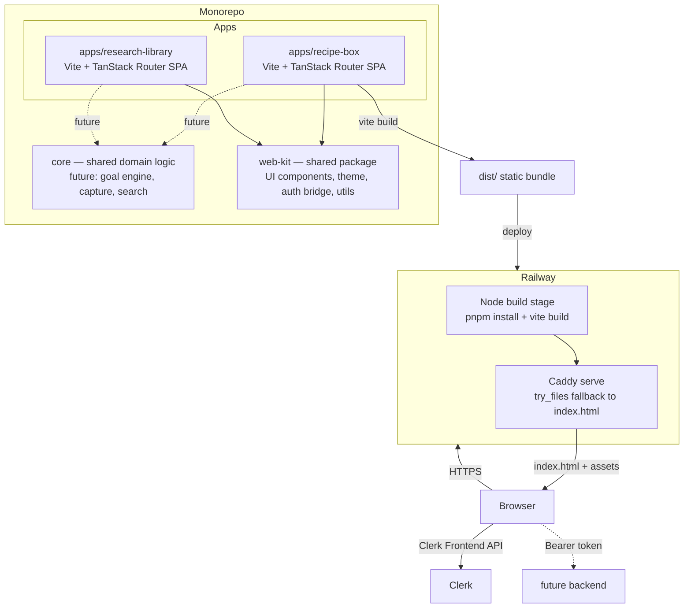
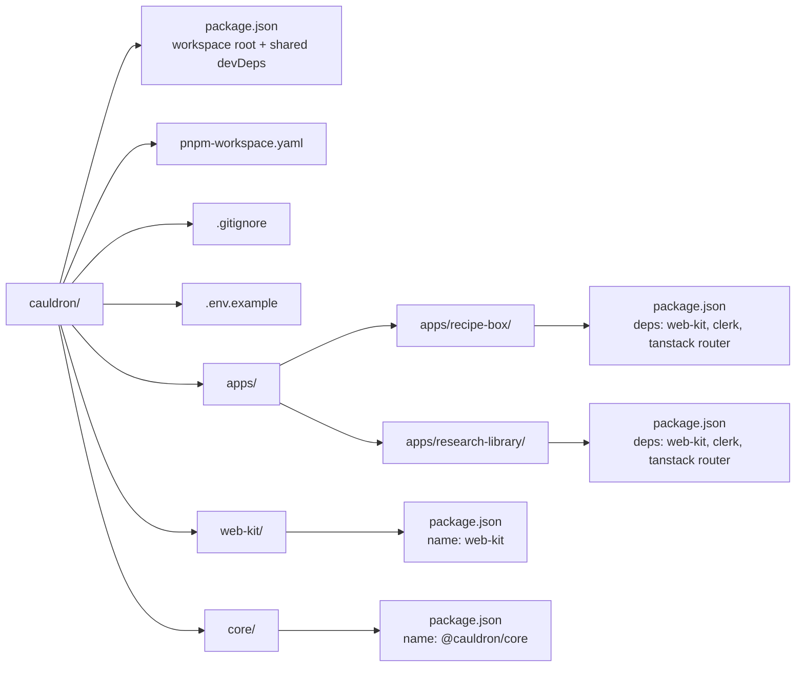
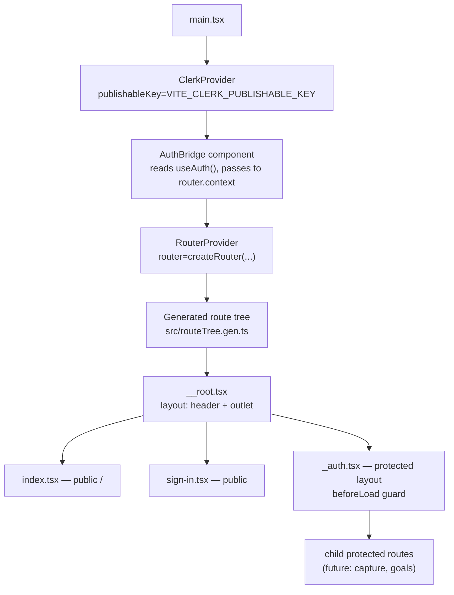

# Design Document

## 01-foundation

The walking skeleton: the smallest deployable app that proves the Cauldron tech stack works end to end — a pnpm monorepo, a web app shell with type-safe routing and theming, Clerk authentication, public/protected route guards, environment configuration, Railway deployment, and build/dev tooling. No goal-engine, capture, or search features yet; this is the skeleton those features plug into.

## Overview

Cauldron is a goal-driven capture-and-compile engine. One skeleton powers two apps — Recipe Box and Research Library. The foundation spec delivers the shared spine first: a monorepo layout, a shared `web-kit` package, a Vite + TanStack Router app shell with shadcn/ui and Tailwind, Clerk auth wired into route guards, and a Railway deployment that serves a static SPA with client-side routing fallback.

The scope is deliberately narrow. Every requirement here exists to prove the stack is alive and to leave a structure that later specs (capture, goal engine, search) can plug into without restructuring. The two apps share `web-kit` for UI components, theme tokens, the auth context bridge, and utilities; they share `core` for future domain logic. Only Recipe Box is deployed in this spec, but Research Library is scaffolded so the monorepo shape is proven by two real consumers of the shared packages.

### Design Goals

- **Prove the stack end to end.** A browser visit to the deployed URL shows the app load, the home page render, and the Clerk sign-in flow work in production.
- **Share, don't duplicate.** `web-kit` is imported by both apps via the pnpm workspace protocol, so a UI or auth change lands once.
- **Keep auth as UX, not as a security boundary.** Client-side route guards redirect unauthenticated users; the design notes explicitly that protected data must be authorized server-side in future specs.
- **Make the theme swappable.** Tailwind CSS variables back shadcn/ui so a theme can be swapped later without touching components.
- **Fail fast on misconfiguration.** Missing env vars stop startup with a clear message rather than a runtime crash deep in a component.

### Out of Scope

- Goal engine, capture, search, or any domain feature.
- A backend API service (the secret key is staged in `.env.local` for a future backend but unused now).
- Server-side rendering (TanStack Router is used in client-side SPA mode, not TanStack Start/SSR).
- Deploying Research Library (scaffolded only).

## Architecture

### High-Level Architecture

The system is a pnpm workspace monorepo. A shared `web-kit` package is consumed by two Vite + TanStack Router apps. Each app is a standalone static SPA bundled by Vite into `dist/` and served on Railway by Caddy, which falls back to `index.html` for client-side routes. Clerk runs entirely client-side via `@clerk/clerk-react`; the publishable key ships to the browser, while the secret key stays server-side (unused until a backend exists).



### Monorepo Layout

The workspace is managed by pnpm. A root `package.json` declares workspace tooling; `pnpm-workspace.yaml` enumerates the packages. Both apps depend on `web-kit` via the `workspace:*` protocol so edits to the shared package are picked up immediately in dev and linked in the build.



**Rationale — pnpm over npm/yarn workspaces:** pnpm uses a content-addressable store on disk, so shared dependencies are installed once and hard-linked across packages. It also enforces strict dependency isolation (a package can't accidentally import a dep it didn't declare), which catches wiring bugs early in a monorepo with two app consumers.

**Rationale — `web-kit` as a real workspace package (not a folder alias):** A published-style package with its own `package.json`, `name`, and `exports` map means both apps import it the same way they'd import any npm package. The `workspace:*` protocol resolves to the local path in dev and is substituted with a real version on publish. This keeps import paths stable and lets `web-kit` evolve its own `exports` contract.

### Application Architecture (per app)

Each app is a client-side SPA. The composition order matters: Clerk's `ClerkProvider` must wrap the router so that the auth bridge component can read `useAuth()` and hand the value to `RouterProvider` via `router.context`.



The `AuthBridge` is the key integration point. React hooks can't be called inside TanStack Router's `beforeLoad` directly (it runs outside the React render cycle), so a thin wrapper component extracts the auth state from `useAuth()` and passes it down through `router.context`. Each `beforeLoad` guard then reads `context.auth` to decide whether to redirect.

## Components and Interfaces

### Monorepo Root

**Root `package.json`** — declares the workspace and shared dev tooling (TypeScript, ESLint, pnpm). Scripts at the root orchestrate across workspaces.

```jsonc
// cauldron/package.json
{
  "name": "cauldron",
  "private": true,
  "type": "module",
  "scripts": {
    "dev": "pnpm --filter recipe-box dev",
    "build": "pnpm -r --filter=recipe-box build",
    "lint": "eslint .",
    "typecheck": "pnpm -r typecheck"
  },
  "devDependencies": {
    "typescript": "^5.6.0",
    "eslint": "^9.0.0"
  }
}
```

```yaml
# pnpm-workspace.yaml
packages:
  - 'core'
  - 'web-kit'
  - 'apps/*'
```

### `web-kit` Package

The shared UI and auth layer. It exports shadcn/ui components, the Tailwind theme (CSS variables), the Clerk auth-bridge helpers, and generic utilities. It has no app-specific routing — each app owns its own route tree.

```jsonc
// web-kit/package.json
{
  "name": "web-kit",
  "version": "0.0.0",
  "private": true,
  "type": "module",
  "exports": {
    "./components": "./src/components/index.ts",
    "./components/*": "./src/components/*/index.ts",
    "./lib/utils": "./src/lib/utils.ts",
    "./theme.css": "./src/theme.css",
    "./auth": "./src/auth/index.ts"
  },
  "peerDependencies": {
    "react": "^18.0.0",
    "@clerk/clerk-react": "^6.0.0"
  }
}
```

**Exports map rationale:** A scoped `exports` map (rather than a single barrel) lets tree-shaking and IDE auto-imports stay precise, and it documents the public surface of `web-kit` as a contract both apps depend on.

### `@cauldron/core`

Scaffolded as a near-empty workspace package in this spec. It exists to prove the monorepo can host a shared logic package; later specs fill it with the goal engine, capture, and search logic. Its `package.json` declares the name and a `typecheck` script; no runtime code is required yet beyond a placeholder.

### App Shell (Recipe Box)

**`apps/recipe-box/vite.config.ts`** — registers the TanStack Router plugin for file-based route generation.

```ts
import { defineConfig } from 'vite'
import react from '@vitejs/plugin-react'
import { TanStackRouterVite } from '@tanstack/router-plugin/vite'
import path from 'node:path'

export default defineConfig({
  plugins: [
    TanStackRouterVite({ target: 'react', autoCodeSplitting: true }),
    react(),
  ],
  resolve: {
    alias: { '@': path.resolve(__dirname, './src') },
  },
})
```

The `@tanstack/router-plugin` watches `src/routes/**`, generates `src/routeTree.gen.ts` on file save and at build time, and is the mechanism behind type-safe file-based routing. The generated file is gitignored from linting/formatting (it's managed by the plugin).

**`apps/recipe-box/src/main.tsx`** — the composition root.

```tsx
import { ClerkProvider } from '@clerk/clerk-react'
import { RouterProvider } from '@tanstack/react-router'
import { StrictMode } from 'react'
import { createRoot } from 'react-dom/client'
import { createRouter } from './router'
import { routeTree } from './routeTree.gen'
import { validateEnv } from './lib/env'
import './theme.css'

// Fail fast before React mounts if env is missing.
const env = validateEnv()

const router = createRouter({ routeTree })

createRoot(document.getElementById('root')!).render(
  <StrictMode>
    <ClerkProvider publishableKey={env.VITE_CLERK_PUBLISHABLE_KEY}>
      <RouterProvider router={router} />
    </ClerkProvider>
  </StrictMode>,
)
```

**`apps/recipe-box/src/router.tsx`** — the auth bridge. A wrapper component reads `useAuth()` and injects the value into the router's context so `beforeLoad` guards can access it without calling a hook outside React.

```tsx
import { createRouter } from '@tanstack/react-router'
import { useAuth } from '@clerk/clerk-react'
import type { RouterProviderProps } from '@tanstack/react-router'

export type AppRouterContext = {
  auth: {
    isLoaded: boolean
    isSignedIn: boolean
    userId: string | null
  }
}

// Bridge: extract hook state and pass into router.context.
export const AuthBridge = ({ router }: { router: ReturnType<typeof createRouter> }) => {
  const auth = useAuth()
  return <RouterProvider router={router} context={{ auth }} />
}

export const createAppRouter = (routeTree: any) => {
  const router = createRouter({
    routeTree,
    context: { auth: { isLoaded: false, isSignedIn: false, userId: null } },
  })
  return router
}
```

**`apps/recipe-box/src/lib/env.ts`** — fail-fast validation of required environment variables. Reads from `import.meta.env` (Vite-injected) and throws a clear error listing every missing key before React mounts.

```ts
function required(name: string): string {
  const value = import.meta.env[name] as string | undefined
  if (!value) {
    throw new Error(
      `Missing required environment variable: ${name}. ` +
      `Copy .env.example to .env.local and fill in the values.`
    )
  }
  return value
}

export function validateEnv() {
  return {
    VITE_CLERK_PUBLISHABLE_KEY: required('VITE_CLERK_PUBLISHABLE_KEY'),
    VITE_API_BASE_URL: import.meta.env.VITE_API_BASE_URL ?? '',
  }
}
```

### Route Tree

TanStack Router file-based routing maps the `src/routes` directory to a route tree. The naming convention encodes behavior:

| File | Route | Visibility | Guard |
|------|-------|------------|-------|
| `__root.tsx` | layout (header + `<Outlet />`) | — | — |
| `index.tsx` | `/` | public | none |
| `sign-in.tsx` | `/sign-in` | public | none |
| `_auth.tsx` | pathless layout | protected | `beforeLoad` checks `context.auth.isSignedIn` |
| `_auth/capture.tsx` | `/capture` (future) | protected | inherited from `_auth` |

**`beforeLoad` guard pattern** — the pathless `_auth` layout route protects all children. Because a parent's `beforeLoad` runs before any child's, one guard secures the whole subtree. When the user is signed out, it throws a `redirect()` to `/sign-in`, preserving the intended destination as a search param so the user returns after signing in.

```tsx
// apps/recipe-box/src/routes/_auth.tsx
import { createFileRoute, redirect, Outlet } from '@tanstack/react-router'
import type { AppRouterContext } from '../router'

export const Route = createFileRoute('/_auth')({
  beforeLoad: ({ context, location }) => {
    const auth = (context as AppRouterContext).auth
    if (!auth.isLoaded) return // still resolving; render nothing or a loader
    if (!auth.isSignedIn) {
      throw redirect({
        to: '/sign-in',
        search: { redirect: location.href },
        replace: true,
      })
    }
  },
  component: () => <Outlet />,
})
```

**Rationale — pathless layout route for protection:** A single `beforeLoad` on `_auth` protects every child route and avoids repeating the guard per route. Adding a new protected page is just dropping a file into `_auth/` — the guard is inherited.

### Header Component

The shared header lives in `web-kit` so both apps render the same chrome. It uses Clerk's `useAuth()` and the `<Show>` primitive (Clerk Core 3's unified conditional renderer) to display identity and a sign-out action when signed in.

```tsx
// web-kit/src/components/header/index.tsx
import { Show, UserButton, useAuth } from '@clerk/clerk-react'

export function Header({ appName }: { appName: string }) {
  const { isLoaded, isSignedIn, userId } = useAuth()
  return (
    <header className="border-b">
      <nav>{appName}</nav>
      <Show when="signed-in">
        <UserButton />
      </Show>
    </header>
  )
}
```

### API Token Handling

When the app makes API calls, it attaches the Clerk session token as a Bearer token. `useAuth().getToken()` returns a promise resolving to the short-lived JWT.

```tsx
// web-kit/src/auth/api-client.ts
import { useAuth } from '@clerk/clerk-react'

export function useApiClient() {
  const { getToken } = useAuth()
  return async (path: string, init: RequestInit = {}) => {
    const token = await getToken()
    return fetch(path, {
      ...init,
      headers: {
        ...(token ? { Authorization: `Bearer ${token}` } : {}),
        ...init.headers,
      },
    })
  }
}
```

This is staged for future specs (no backend exists yet), but the pattern and the `VITE_API_BASE_URL` env var are in place so the wiring is ready.

### Theme

`web-kit/src/theme.css` defines Tailwind CSS variables in the shadcn/ui convention (light/dark via `:root` and `.dark`). shadcn/ui components reference these variables (`bg-background`, `text-foreground`, etc.), so swapping the theme means changing variable values — no component edits.

```css
:root {
  --background: 0 0% 100%;
  --foreground: 240 10% 3.9%;
  --primary: 240 5.9% 10%;
  /* ...remaining shadcn/ui tokens */
}

.dark {
  --background: 240 10% 3.9%;
  --foreground: 0 0% 98%;
  /* ... */
}
```

**Rationale — CSS variables over Tailwind config colors:** shadcn/ui's `cssVariables` option (the default) stores the palette as CSS custom properties mapped into Tailwind via `@theme`. This makes the theme a data swap rather than a rebuild, satisfying the "theme can be swapped later" requirement.

## Data Models

This spec has minimal persistent state — it's a skeleton. The "data models" here are configuration shapes and the auth context type, not domain entities.

### Environment Configuration Shape

```ts
interface AppEnv {
  /** Clerk publishable key — ships to the client. Required. */
  VITE_CLERK_PUBLISHABLE_KEY: string
  /** Base URL for the future backend API. Optional until a backend exists. */
  VITE_API_BASE_URL: string
}
```

Variables prefixed `VITE_` are exposed to client code by Vite via `import.meta.env`. The Clerk secret key (`CLERK_SECRET_KEY`) is staged in `.env.local` for a future backend but is **not** prefixed with `VITE_`, so Vite never bundles it into the client. This is a critical security boundary: only publishable, non-secret values get the `VITE_` prefix.

### Router Context (Auth State)

```ts
interface AppRouterContext {
  auth: {
    /** Clerk has finished resolving the initial auth state. */
    isLoaded: boolean
    /** Whether a user session is active. */
    isSignedIn: boolean
    /** Clerk user ID when signed in, null otherwise. */
    userId: string | null
  }
}
```

This is the contract between the `AuthBridge` component and every `beforeLoad` guard. It's a snapshot of `useAuth()`'s relevant fields, deliberately narrowed to what guards need so the router context stays stable.

### Route Search Params

```ts
interface SignInSearch {
  /** Where to return the user after a successful sign-in. */
  redirect?: string
}
```

## Error Handling

### Missing Environment Variables

`validateEnv()` runs synchronously at the top of `main.tsx` before `createRoot().render()`. If a required `VITE_` variable is absent, it throws an `Error` with a message naming every missing key and pointing the developer to `.env.example`. Because this throws before React mounts, the user sees a console error (or a blank page with a clear devtools message) rather than a partial render that fails later inside a component. In production, Railway's deploy logs surface the same error.

### Clerk Auth Not Yet Loaded

`useAuth()` returns `isLoaded: false` during Clerk's initial resolve. The `beforeLoad` guard handles this by returning early (no redirect) so the route doesn't flicker the user to `/sign-in` mid-resolve. The `__root` layout renders a lightweight loading state while `!isLoaded` to avoid a flash of signed-out content.

### Unauthenticated Access to a Protected Route

The `_auth` layout's `beforeLoad` throws a `redirect()` to `/sign-in` with `replace: true` (so the protected URL doesn't linger in history) and a `redirect` search param preserving the intended destination. After a successful sign-in, the sign-in route reads that param and navigates the user back via `router.history.push`.

### Clerk Provider Missing Publishable Key

`ClerkProvider` requires a `publishableKey`. Because `validateEnv()` guarantees `VITE_CLERK_PUBLISHABLE_KEY` is present before `ClerkProvider` renders, this case is unreachable in normal flow. If it ever is, Clerk throws its own descriptive error.

### SPA Deep Link / Refresh on a Client Route

When a browser requests a client-side route directly (refresh, bookmark, shared link), there is no file at that path on the static host. Caddy's `try_files {path} /index.html` serves `index.html` instead, letting the TanStack Router take over and render the correct route. Without this, deep links 404. A `/health` rewrite keeps Railway's health check from falling through to `index.html`.

### OAuth Redirect Mismatch in Production

OAuth providers (Google, GitHub, etc.) require each production origin to be allowlisted — in the Clerk dashboard and in each provider's own authorized-redirect console. The most common "worked locally, broken in prod" failure is a missing allowlist entry. The deployment checklist (see Testing Strategy) includes verifying the Railway URL is allowlisted before first sign-in.

## Testing Strategy

Property-based testing is not applicable to this feature, so no Correctness Properties are defined. The feature is a walking skeleton composed of infrastructure configuration, UI rendering, external service integration (Clerk), and deployment setup:

- **Monorepo structure, env config, deployment (Railway/Caddy)** are declarative configuration and IaC, not pure functions with input/output behavior — there's no "for all inputs X, property P(X) holds" statement to make about whether a directory layout exists or a Caddyfile's `try_files` is present.
- **The web app shell, header, and routing** are UI rendering — verified by snapshot and example-based tests.
- **Clerk auth** is an external service; client-side guards are UX, and `getToken()`/`isSignedIn` are Clerk's own behavior (already tested by Clerk).
- **Build tooling** (TypeScript strict, ESLint, Kiro hooks) is configuration verified by smoke checks.

Testing therefore uses example-based unit tests, snapshot tests, integration tests, and smoke checks instead.

### Unit / Example Tests

- **`validateEnv()`**: example test that a present env var returns its value and a missing required var throws an `Error` whose message contains the variable name. Edge case: empty-string value is treated as missing.
- **`AuthBridge` / router context**: example test that `useAuth()` state (`isSignedIn: true`) flows into `router.context.auth.isSignedIn`.
- **Header component**: example test that the header renders the app name and shows the `UserButton` when `isSignedIn` is true (mock Clerk), and renders the app name without `UserButton` when signed out.
- **API client**: example test that `useApiClient` attaches `Authorization: Bearer <token>` when `getToken()` resolves a token, and omits the header when the token is `null` (mock `getToken`).

### Snapshot Tests

- **Home page and header**: render the route component / header with mocked auth state and snapshot the output. Catches unintended UI drift when `web-kit` changes.

### Integration Tests (routing + auth)

- **Public route access**: navigate to `/` while signed out → home page renders, no redirect.
- **Protected route redirect**: navigate to a protected route while signed out → redirected to `/sign-in` with a `redirect` search param; after "sign-in", the user lands on the originally requested route. Uses a mocked Clerk auth context to flip `isSignedIn`.
- **Sign-out redirect**: trigger sign-out → redirected to `/` (home).

### Smoke Tests / Build Verification

- **TypeScript strict typecheck**: `pnpm typecheck` runs `tsc --noEmit` across all workspaces; the build fails on any type error. This enforces Requirement 7.1 and 7.4.
- **Production build**: `pnpm build` produces `apps/recipe-box/dist/` with `index.html` and hashed assets, exit code 0. Verifies Requirement 6.1 and 7.4.
- **ESLint**: `pnpm lint` exits 0 with no errors. Verifies the lint tooling is wired (Requirement 7.2).
- **Vite HMR**: manual/CI smoke that `pnpm dev` starts and serves the app on localhost (Requirement 7.3).
- **Kiro PostFileSave hook**: a file save triggers the ESLint hook; verified by the hook config presence and a save in dev (Requirement 7.2).

### Deployment Verification (Production)

End-to-end production checks, run once against the Railway URL:

1. Open the public URL in a browser → the app loads and the home page renders (Requirement 6.2, 6.5).
2. The Clerk sign-in page renders when navigating to sign-in (Requirement 6.5).
3. Complete a sign-in → the header shows the user's identity (Requirement 6.6).
4. Refresh on a client-side route → the page loads (not a 404), proving the `try_files` fallback (Requirement 6.4).
5. Confirm `VITE_CLERK_PUBLISHABLE_KEY` is available to the deployed bundle (Requirement 6.3).
6. Confirm the production origin is allowlisted in Clerk for OAuth (Requirement 6.5 / OAuth redirect handling).

These are one-shot integration verifications against a live deploy, not repeated property tests — the behavior doesn't vary meaningfully with input, and they exercise real external services (Railway, Clerk).

## Design Decisions and Rationale

| Decision | Rationale |
|----------|-----------|
| pnpm workspaces | Fast installs via content store; strict dependency isolation prevents accidental cross-package imports; single lockfile across the monorepo. |
| `web-kit` as a workspace package with an `exports` map | Both apps import a real package, not a path alias; the `exports` map documents the public contract; `workspace:*` resolves locally in dev. |
| TanStack Router file-based routing via `@tanstack/router-plugin` | Type-safe routes auto-generated from files; route params, search params, and `<Link>` targets are compile-checked. Adding a page is adding a file. |
| Router context bridge for Clerk auth | React hooks can't run in `beforeLoad` (outside React). A wrapper component reads `useAuth()` and passes the value into `router.context`, making auth state available to guards without breaking hook rules. |
| Pathless `_auth` layout route for protection | One `beforeLoad` guard on the layout protects all children; new protected pages inherit it automatically. |
| Clerk client-side only (publishable key to browser) | This is a SPA with no backend yet; the publishable key's authority is limited to "issue a JWT for this session." The secret key stays server-side for a future backend. Guards are explicitly UX, not a security boundary. |
| Caddy for Railway static serving | Railway's recommended SPA host; `try_files {path} /index.html` handles client-side routing fallback; `/health` rewrite keeps health checks clean. |
| CSS variables for theming (shadcn/ui default) | Theme swaps are data changes, not component edits; satisfies "theme can be swapped later" without touching `web-kit` components. |
| Fail-fast `validateEnv()` before React mounts | Catches missing config at startup with a clear message, not a runtime crash deep in a component tree. |
| Generated route tree gitignored from lint/format | `routeTree.gen.ts` is managed by the plugin; linting it produces noise and churn. |
