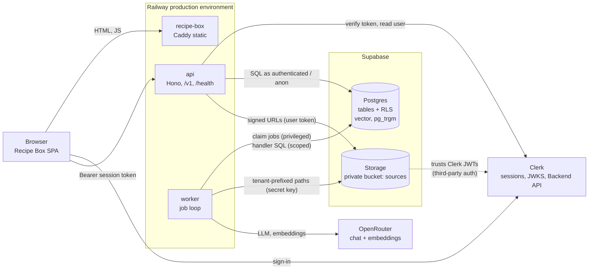
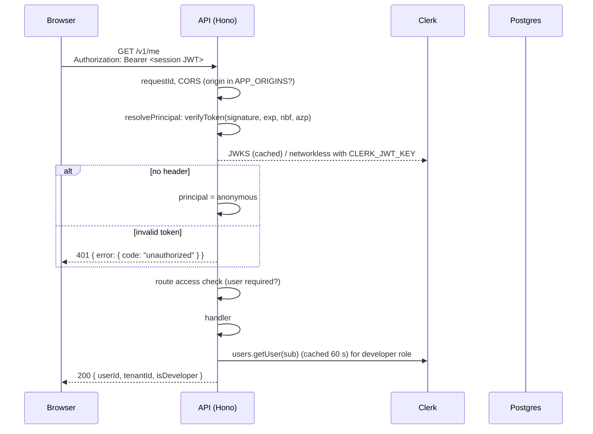
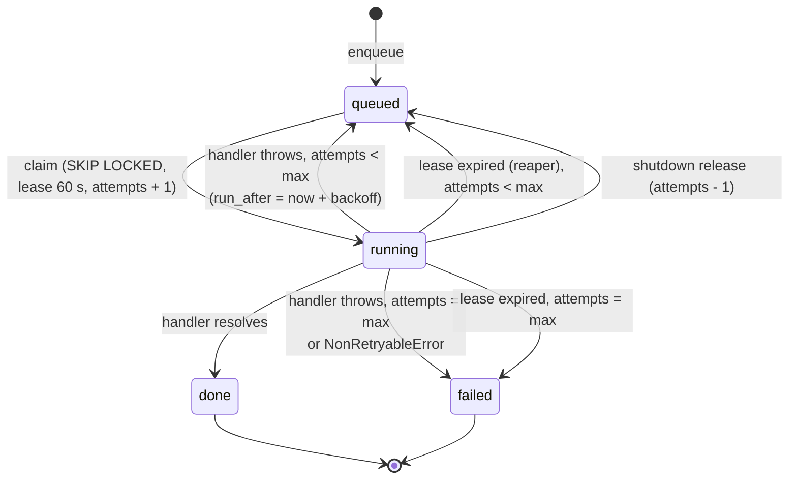
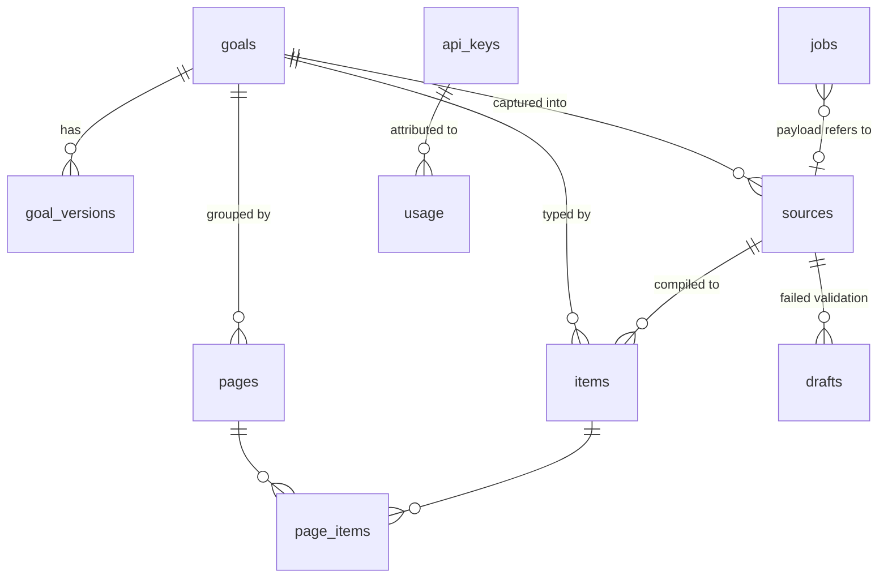

# Design Document

## 01.5-backend-foundation

The smallest backend that proves the server side works end to end: a `/v1` API service with Clerk token verification and generated OpenAPI, the shared Postgres schema with row-level security, private raw-source storage, a Postgres job queue with a worker that runs only a `ping` handler, and the LLM and embedding provider interfaces with OpenRouter and mock implementations. Feature specs (goal-engine, capture-compile, search) add endpoints, job handlers and columns on top of it.

## Overview

The backend adds two deployable services and one database to the monorepo built in `01-foundation`:

- **`services/api`**: a Hono HTTP service. Every endpoint lives under `/v1`, is declared once with a Zod schema, and appears in the generated OpenAPI document. A request is authenticated by a Clerk session token in the `Authorization` header, or treated as anonymous when it carries no token.
- **`services/worker`**: a Node process that claims jobs from the `jobs` table with `FOR UPDATE SKIP LOCKED`, holds them under a 60 s lease, and dispatches them to registered handlers. This spec registers `ping` and the background `reembed` handler.
- **Supabase**: Postgres with `vector` and `pg_trgm`, the ten shared tables, RLS on every table that holds user data, and a private `sources` Storage bucket. Clerk is registered as a third-party auth provider, so Clerk session tokens satisfy Supabase's `auth.jwt()`.

Domain and data-access code that both services need lives in `@cauldron/core`, under Node-only subpath exports, so the API and the worker share one tenant-scoped data-access helper, one queue implementation and one provider layer.

### Design Goals

- **The database enforces tenancy.** Every user query runs inside a transaction that switches to the `authenticated` (or `anon`) Postgres role and sets the caller's JWT claims, so RLS applies even though the services connect with a privileged connection string. A bug in an endpoint cannot return another tenant's rows.
- **Closed by default.** An endpoint requires a signed-in user unless its definition says `access: 'anonymous'`. The OpenAPI document and the auth middleware are generated from the same definition, so the document cannot drift from the enforcement.
- **One queue, no extra infrastructure.** The `jobs` table is the queue (capture-compile Requirement 4.1). Delivery is at least once; handlers must be idempotent.
- **Deterministic tests.** Every LLM and embedding call goes through a provider interface. Tests and demo mode use a mock that replays recordings and fails on an unrecorded request.
- **Same path locally and in production.** Migrations run through the Supabase CLI in both places. Services read env through one fail-fast validator.

### Out of Scope

- Goal drafting, validation, versioning and startup registration (goal-engine). This spec creates the tables and the reserved system owner they need.
- Capture endpoints, compile handlers, item indexing and page summaries (capture-compile).
- Search queries (search). This spec creates the indexes.
- API keys as a credential, rate limits and spend caps (auth-abuse, public-api-sdk). This spec creates the `api_keys` and `usage` tables only.
- The MCP service (mcp-server).
- TanStack Query in `web-kit` (public-api-sdk). The Recipe Box check uses a plain fetch.

## Architecture

### System Context



The browser never talks to Supabase directly. All data goes through `/v1` (public-api-sdk Requirement 1.2).

### Monorepo Changes

```
cauldron/
├─ pnpm-workspace.yaml        # + 'services/*'
├─ package.json               # + dev:stack, db:*, test:db scripts; engines.node >=24; + supabase CLI devDep
├─ .nvmrc                     # 24
├─ Dockerfile.service         # one image recipe for api and worker (ARG SERVICE)
├─ Dockerfile.app             # one image recipe for static apps (ARG APP), served by Caddy
├─ Caddyfile                  # root becomes {$SITE_ROOT}, so one file serves any app
├─ nixpacks.toml              # removed: Railway doesn't use it
├─ .github/workflows/
│  └─ migrate.yml             # applies supabase/migrations on push to main
├─ .env.example               # + every backend variable
├─ supabase/
│  ├─ config.toml             # local stack: Clerk third-party auth, storage, Data API off
│  ├─ migrations/             # ordered SQL migrations (Requirement 3.4)
│  └─ seed.sql                # local-only seed (system owner rows come later from goal-engine)
├─ core/
│  ├─ package.json            # exports map: ".", "./env", "./providers", "./providers/mock", "./db", "./queue", "./storage"
│  └─ src/
│     ├─ env/                 # parseEnv(): fail-fast env validation for services
│     ├─ providers/           # LLM + embedding interfaces, OpenRouter, mock
│     ├─ db/                  # connection, Actor, withActor() data-access helper
│     ├─ queue/               # enqueue, claim, heartbeat, complete, fail, release, reap
│     └─ storage/             # source storage paths, signed URLs
└─ services/
   ├─ api/                    # package "api"
   │  └─ src/
   │     ├─ index.ts          # entry: env, deps, serve, graceful shutdown
   │     ├─ env.ts
   │     ├─ app.ts            # createApp(deps): middleware, routes, OpenAPI doc
   │     ├─ http/             # errors.ts, define-route.ts, cors.ts
   │     ├─ auth/             # verify-token.ts, principal.ts, developer.ts
   │     └─ routes/           # health.ts, me.ts
   └─ worker/                 # package "worker"
      └─ src/
         ├─ index.ts          # entry: env, deps, start loop, signal handling
         ├─ env.ts
         ├─ worker.ts         # poll loop, concurrency slots, leases, shutdown
         ├─ maintenance.ts    # lease reaper, re-embed scheduler
         └─ handlers/         # index.ts (registry), ping.ts, reembed.ts
```

**Rationale: server code in `core` subpaths rather than a new `server-kit` package.** The requirements place this work in `/core`, `/services/*` and `/supabase`. `core`'s root export stays isomorphic (types, provider interfaces) so a browser bundle can import goal-engine code from it later; Node-only modules (`./db`, `./queue`, `./storage`) are separate subpaths that a browser bundle never reaches. This follows the scoped-exports convention `web-kit` already uses. A separate `server-kit` package was considered; it adds a fourth package category for code that only two services consume.

### Request Lifecycle (API)



For handlers that touch data, the handler calls `db.withActor(principal.actor, tx => ...)`, which opens a transaction, runs `set local role authenticated` and `set_config('request.jwt.claims', ...)`, then runs the handler's queries.

### Job Lifecycle (Worker)



`status` is the queue's own lifecycle. Handlers report their progress in a separate `stage` column (capture-compile sets `fetching`, `extracting`) and their result in `outcome` (`ready`, `needs_review`). Capture-compile derives the user-facing compile state from `(status, stage, outcome)`: `queued` while queued, the stage while running, the outcome when done, `failed` when failed. Keeping the queue's states generic lets every job type share the claim and lease logic.

## Components and Interfaces

### `@cauldron/core/env`: fail-fast configuration

Both services validate `process.env` with a Zod schema before they open a connection or a port.

```ts
// core/src/env/index.ts
import { z } from 'zod'

export class EnvError extends Error {}

export function parseEnv<S extends z.ZodTypeAny>(
  schema: S,
  source: Record<string, string | undefined>,
): z.infer<S> {
  // Empty strings count as missing, matching validateEnv() in the apps.
  const cleaned = Object.fromEntries(
    Object.entries(source).filter(([, v]) => v !== undefined && v !== ''),
  )
  const result = schema.safeParse(cleaned)
  if (!result.success) {
    const names = [...new Set(result.error.issues.map((i) => i.path.join('.')))]
    throw new EnvError(
      `Missing or invalid environment variables: ${names.join(', ')}. ` +
        'See .env.example.',
    )
  }
  return result.data
}
```

The entry point catches `EnvError`, writes the message to stderr and exits with code 1, so Railway's deploy log shows the variable names (Requirement 8.3). Values are never printed.

Provider settings are validated conditionally: when `PROVIDERS=openrouter`, `OPENROUTER_API_KEY` and the model names are required; when `PROVIDERS=mock`, they are not.

### API Service (`services/api`)

**Framework: Hono with `@hono/zod-openapi` on `@hono/node-server`.** A route is declared once with `createRoute()` (method, path, Zod request and response schemas) and the OpenAPI 3.1 document is generated from those declarations (Requirement 1.3). Zod schemas double as runtime validation. Hono's `app.request()` runs requests in-process, which keeps API tests fast and free of open ports.

**App factory.** `createApp(deps)` builds the app from injected dependencies, so tests swap the token verifier, the database and the Clerk client.

```ts
// services/api/src/app.ts (shape)
export interface ApiDeps {
  env: ApiEnv
  db: Db                              // from @cauldron/core/db
  verifyToken: VerifySessionToken     // Clerk in prod, fake in tests
  developerRole: DeveloperRoleLookup  // Clerk Backend API + DEVELOPER_EMAILS
  health: HealthProbe                 // DB ping + embedding staleness
}

export function createApp(deps: ApiDeps) {
  const app = new OpenAPIHono<AppBindings>({ defaultHook: validationErrorHook })
  app.use('*', requestId())
  app.route('/', healthRoutes(deps))            // /health, outside /v1, no CORS, no auth
  const v1 = new OpenAPIHono<AppBindings>({ defaultHook: validationErrorHook })
  v1.use('*', cors(deps.env.APP_ORIGINS))
  v1.use('*', resolvePrincipal(deps.verifyToken))
  registerMe(v1, deps)
  v1.doc31('/openapi.json', openApiInfo)        // anonymous
  app.route('/v1', v1)
  app.notFound(notFoundHandler)
  app.onError(errorHandler)
  return app
}
```

**Route definitions carry their access level.** `defineRoute()` wraps `createRoute()`:

```ts
// services/api/src/http/define-route.ts (shape)
type Access = 'user' | 'anonymous'

export function defineRoute<R extends RouteConfig>(
  config: R & { access?: Access },
) {
  const access = config.access ?? 'user'   // closed by default
  return createRoute({
    ...config,
    security: access === 'user' ? [{ bearerAuth: [] }] : [],
    middleware: access === 'user' ? [requireUser()] : [],
  })
}
```

The OpenAPI document registers a `bearerAuth` HTTP security scheme. `security: []` is the OpenAPI way to mark an operation as public, so the document tells API consumers exactly which endpoints need a token (Requirement 2.4). A test walks the generated document and fails if any operation lacks an explicit `security` field.

**Endpoints in this spec.**

| Method | Path | Access | Purpose |
|--------|------|--------|---------|
| GET | `/health` | none (outside `/v1`) | Railway health check: process up, DB reachable, embedding staleness (Requirements 1.2, 7.6, 9.1) |
| GET | `/v1/openapi.json` | anonymous | Generated OpenAPI document (Requirement 1.3); also proves the anonymous path (Requirement 2.4) |
| GET | `/v1/me` | user | `{ userId, tenantId, isDeveloper }` (Requirement 2.5) |

**`/health` response.** It returns 200 when the database answers `select 1` within 2 s, otherwise 503 with the same body shape. The staleness count is cached for 60 s so repeated probes don't scan `items`.

```json
{
  "status": "ok",
  "service": "api",
  "version": "<RAILWAY_GIT_COMMIT_SHA or 'dev'>",
  "checks": { "database": "ok" },
  "embeddings": {
    "model": "openai/text-embedding-3-small",
    "dimensions": 1536,
    "itemsNeedingReembed": 0
  }
}
```

goal-engine adds an `appGoals` array to this body (goal-engine Requirement 8.5).

**CORS.** `hono/cors` with an origin callback that returns the request origin only if it is in `APP_ORIGINS` (exact match on scheme, host and port), and no `Access-Control-Allow-Origin` header otherwise (Requirement 1.5). Allowed headers: `Authorization`, `Content-Type`. `credentials` stays off because auth uses a header, not cookies. Preflight responses are cached for 10 minutes (`maxAge: 600`).

**Error envelope.** Every failure, including 404s, Zod validation failures and unexpected exceptions, returns:

```json
{
  "error": {
    "code": "unauthorized",
    "message": "A valid session token is required.",
    "status": 401,
    "requestId": "req_01J…",
    "details": []
  }
}
```

```ts
// services/api/src/http/errors.ts (shape)
export type ErrorCode =
  | 'bad_request' | 'validation_failed' | 'unauthorized' | 'forbidden'
  | 'not_found' | 'conflict' | 'rate_limited' | 'internal'

export class ApiError extends Error {
  constructor(
    readonly status: number,
    readonly code: ErrorCode,
    message: string,
    readonly details?: unknown[],
  ) { super(message) }
}
```

`code` values are part of the public contract (Requirement 1.4); later specs add codes but never rename one. `onError` maps `ApiError` to its fields and anything else to `500 internal` with a generic message, logging the stack with the request ID. 401 responses also set `WWW-Authenticate: Bearer`. The error schema is registered as a reusable OpenAPI component so every route documents it.

**Logging.** `pino` JSON logs to stdout with `requestId`, method, path, status and duration. The `Authorization` header and token values are redacted.

### Clerk Token Verification (`services/api/src/auth`)

```ts
// services/api/src/auth/principal.ts
export type Principal =
  | { kind: 'user'; userId: string; tenantId: string; sessionId: string }
  | { kind: 'anonymous' }
```

`resolvePrincipal` middleware:

1. Reads only the `Authorization` header. The `__session` cookie and query-string tokens are ignored, which rules out CSRF against the API.
2. No header → `{ kind: 'anonymous' }`.
3. A header that isn't `Bearer <token>`, or a token that fails verification → 401 immediately, even on anonymous endpoints. A client that sends a broken token should learn about it, not silently get demo data.
4. Valid token → `{ kind: 'user', userId: sub, tenantId: sub, sessionId: sid }` (Requirement 2.2, auth-abuse Requirement 2.1).

Verification uses `verifyToken()` from `@clerk/backend` with:

- `authorizedParties: env.APP_ORIGINS`, so the `azp` claim must name one of the app origins (Requirement 2.1).
- `jwtKey: env.CLERK_JWT_KEY` when set (networkless verification with the instance's PEM public key), otherwise `secretKey`, in which case the JWKS is fetched and cached by the SDK.
- Signature, `exp` and `nbf` checks with the SDK's default clock skew.

`requireUser()` (attached by `defineRoute` to `access: 'user'` routes) throws `ApiError(401, 'unauthorized')` when the principal is anonymous, before the handler runs (Requirement 2.3).

**Developer role (auth-abuse Requirement 11).** Session tokens don't carry email verification status, so the role is computed on the server from Clerk's Backend API:

```ts
// services/api/src/auth/developer.ts (shape)
export async function isDeveloper(userId: string): Promise<boolean> {
  const user = await clerk.users.getUser(userId)            // cached 60 s per user
  if (user.publicMetadata?.role === 'developer') return true
  return user.emailAddresses.some(
    (e) =>
      e.verification?.status === 'verified' &&
      developerEmails.has(e.emailAddress.toLowerCase()),
  )
}
```

`DEVELOPER_EMAILS` is a comma-separated list, lower-cased at startup. The role is never read from a request body or header (auth-abuse Requirement 11.4). If the Clerk Backend API call fails, `/v1/me` returns 503 `internal` rather than guessing `false`. A cached `false` could wrongly hide the developer section for up to 60 s; a guessed `true` would be a privilege bug.

### Data Access (`@cauldron/core/db`)

**Driver: `postgres` (postgres.js) with hand-written SQL.** The schema is defined in SQL migrations (Requirement 3.4). An ORM schema would duplicate it. postgres.js tagged templates parameterize every value, and its transaction API maps directly onto the `set local` pattern below. Kysely was considered for typed query building; it can be added later without changing the helper's contract.

**Connections.** Both services use `DATABASE_URL`, Supabase's transaction-mode pooler (port 6543), with `prepare: false` because transaction pooling doesn't keep prepared statements. `set local` and `set_config(..., true)` are transaction-scoped, so they're safe on a pooled connection. Pool size: API 10, worker `WORKER_CONCURRENCY + 2`.

**Actors.**

```ts
// core/src/db/actor.ts
export const SYSTEM_OWNER = 'system'   // reserved tenant_id/user_id for app goals (Requirement 3.3)

export type Actor =
  | { kind: 'user'; userId: string; tenantId: string }
  | { kind: 'anonymous' }               // reads app goals + public demo tenant only
  | { kind: 'system' }                  // app-goal registration only (goal-engine Requirement 8)
```

Clerk user IDs start with `user_`, so the value `system` can't collide with a real user.

**The data-access helper.** `withActor` is the single way to run user-data queries (Requirement 4.3, auth-abuse Requirement 1.6):

```ts
// core/src/db/scoped.ts (shape)
export interface Scoped {
  sql: TransactionSql   // queries run under the actor's RLS context
  actor: Actor
  tenantId: string | null
}

export async function withActor<T>(
  db: Db,
  actor: Actor,
  fn: (scope: Scoped) => Promise<T>,
): Promise<T> {
  return db.raw.begin(async (sql) => {
    if (actor.kind === 'user') {
      await sql`select set_config('request.jwt.claims', ${JSON.stringify({
        sub: actor.userId, role: 'authenticated',
      })}, true)`
      await sql`set local role authenticated`
    } else if (actor.kind === 'anonymous') {
      await sql`select set_config('request.jwt.claims', '{"role":"anon"}', true)`
      await sql`set local role anon`
    }
    // system: stays on the connection role (bypasses RLS); see below.
    return fn({ sql, actor, tenantId: tenantOf(actor) })
  })
}
```

Two layers apply the tenant filter:

1. **RLS, on every statement.** Supabase's `auth.jwt()` reads `request.jwt.claims`, so the policies below filter every query inside `fn` to the actor's tenant, including queries a developer forgot to filter.
2. **Explicit predicates in repository functions.** Query functions in later specs take a `Scoped` and include `tenant_id = ${scope.tenantId}`. The predicate lets Postgres use the `(tenant_id, …)` indexes and keeps queries correct if they're ever reviewed without the RLS context in mind.

The privileged connection (`db.raw`) is not exported from `@cauldron/core/db`. Only two modules see it: `withActor` itself and `@cauldron/core/queue`, whose claim and reap queries must cross tenants. An ESLint `no-restricted-imports` rule blocks importing `postgres` anywhere outside `core/src/db/**` and `core/src/queue/**`.

The `system` actor exists so goal-engine's startup registration can write rows owned by `system`, which RLS forbids to every user (auth-abuse Requirement 2.5). It runs as the connection role and its scope filters on `tenant_id = 'system'`. It is exported from a separate subpath (`@cauldron/core/db/system`) that only the API's registration module imports; a test asserts no other file imports it.

### Job Queue (`@cauldron/core/queue`)

```ts
// core/src/queue/types.ts
export type JobStatus = 'queued' | 'running' | 'done' | 'failed'

export interface Job<P = unknown> {
  id: string
  tenantId: string
  userId: string
  type: string
  payload: P
  status: JobStatus
  stage: string | null
  outcome: string | null
  attempts: number
  maxAttempts: number
  runAfter: Date
  leaseExpiresAt: Date | null
  lockedBy: string | null
  lastError: string | null
  failureReason: string | null
  dedupeKey: string | null
}
```

| Function | Connection | Behavior |
|----------|------------|----------|
| `enqueue(scope, { type, payload, dedupeKey?, runAfter?, maxAttempts? })` | scoped | Inserts under the actor's tenant. With a `dedupeKey`, `on conflict do nothing` against the partial unique index, so a job already queued or running isn't queued twice. |
| `claim(workerId, types)` | privileged | Claims one job (SQL below). |
| `heartbeat(job)` | privileged | `lease_expires_at = now() + 60 s` where `id` and `attempts` match and `status = 'running'`. Returns `false` if the lease was lost. |
| `setStage(job, stage)` | privileged, fenced | Updates `stage` for progress reporting. |
| `complete(job, outcome?)` | privileged, fenced | `status = 'done'`, `finished_at = now()`. |
| `fail(job, error, { retryable })` | privileged, fenced | Back to `queued` with backoff (`run_after = now() + 2^attempts s`), or `failed` with `failure_reason` when attempts are used up or the error is not retryable. |
| `release(job)` | privileged, fenced | Shutdown path: `queued`, `attempts = attempts - 1`, lease cleared. |
| `reapExpired()` | privileged | Returns expired-lease jobs to `queued`, or `failed` with reason "timed out" at max attempts. |

**Claim query** (Requirement 6.1, 6.2):

```sql
with next as (
  select id
  from jobs
  where status = 'queued'
    and run_after <= now()
    and type = any(${types})
  order by run_after, created_at
  for update skip locked
  limit 1
)
update jobs j
set status = 'running',
    attempts = j.attempts + 1,
    locked_by = ${workerId},
    lease_expires_at = now() + interval '60 seconds',
    started_at = now(),
    updated_at = now()
from next
where j.id = next.id
returning j.*;
```

**Fencing.** Every write after a claim matches `id = $id and attempts = $attempts and status = 'running'`. If the reaper re-queued the job and another worker claimed it (incrementing `attempts`), the stale worker's writes affect zero rows and it discards its result. Combined with idempotent handlers, a lost lease never produces a duplicate result (capture-compile Requirement 4.4).

**Reaper** (Requirement 6.2, capture-compile Requirement 4.3):

```sql
update jobs
set status = case when attempts >= max_attempts then 'failed' else 'queued' end,
    failure_reason = case when attempts >= max_attempts then 'timed out' else failure_reason end,
    last_error = 'lease expired',
    locked_by = null,
    lease_expires_at = null,
    updated_at = now()
where status = 'running' and lease_expires_at < now()
returning id, status;
```

`max_attempts` defaults to 3. The worker runs the reaper every 15 s, so an abandoned job returns to `queued` 60–75 s after its last heartbeat.

### Worker Service (`services/worker`)

```ts
// services/worker/src/handlers/index.ts (shape)
export interface HandlerContext<P> {
  job: Job<P>
  scope: <T>(fn: (s: Scoped) => Promise<T>) => Promise<T>  // withActor(job's user)
  storage: TenantStorage                                  // bound to job.tenantId
  providers: Providers
  signal: AbortSignal                                     // aborted on lease loss or shutdown timeout
  setStage: (stage: string) => Promise<void>
  log: Logger
}

export type JobHandler<P = unknown> = (ctx: HandlerContext<P>) => Promise<{ outcome?: string } | void>

export const handlers: Record<string, JobHandler> = {
  ping: async () => {},            // Requirement 6.3: no-op, marks its job done
  reembed: reembedHandler,         // Requirement 7.6
}
```

Handlers get a database scope and a storage client bound to the job's own user, never a privileged handle (Requirement 4.3, auth-abuse Requirement 8.1). A job whose `type` has no registered handler is never claimed, because `claim()` filters on `type = any(registeredTypes)`. A worker that predates a new job type therefore leaves those jobs for a newer worker.

**Loop.**

- `WORKER_CONCURRENCY` slots (default 4). While a slot is free and the worker isn't stopping, it calls `claim()`. When nothing is claimable it sleeps `POLL_INTERVAL_MS` (default 1000 ms). One second of polling keeps queue latency well inside the capture-compile latency budget (10 s p90) without LISTEN/NOTIFY, which the transaction pooler doesn't support.
- Each running job gets a heartbeat timer every 20 s. If `heartbeat()` returns `false`, the job's `AbortSignal` fires and its result is discarded.
- A handler that throws `NonRetryableError(reason)` goes straight to `failed` with that reason (capture-compile Requirement 4.5). Any other error is retried.
- Every 15 s the worker runs `reapExpired()`. Every 5 minutes it runs the re-embed scheduler.

**Shutdown** (Requirement 6.4). On `SIGTERM` or `SIGINT`:

1. Stop claiming.
2. Wait up to `SHUTDOWN_GRACE_MS` (default 25 000) for running handlers to finish and complete their jobs.
3. Abort the rest through their `AbortSignal`, then `release()` each one so it returns to `queued` without using up an attempt.
4. Close the database pool and exit 0.

Railway sends `SIGTERM` on redeploy and waits `RAILWAY_DEPLOYMENT_DRAINING_SECONDS` before `SIGKILL`; the worker service sets it to 30, above the grace period. If the process is killed anyway, the reaper recovers its jobs after the lease expires.

### Raw-Source Storage (`@cauldron/core/storage`)

- **Bucket.** A migration creates the private bucket `sources` (`public = false`, 20 MB object limit to match the largest capture limit) (Requirement 5.1).
- **Paths.** `{tenantId}/{sourceId}/{index}-{safeFilename}`. `safeFilename` keeps `[A-Za-z0-9._-]`, at most 100 characters (Requirement 5.2).
- **Policies.** On `storage.objects`, for `authenticated`, `select`, `insert` and `delete` require `bucket_id = 'sources' and (storage.foldername(name))[1] = (select auth.jwt() ->> 'sub')`. There is no `update` policy, because raw sources are immutable (capture-compile Requirement 2.1). `anon` gets no policy.

```ts
// core/src/storage/index.ts (shape)
export const MAX_SIGNED_URL_SECONDS = 600

export interface TenantStorage {
  put(sourceId: string, index: number, filename: string, body: Uint8Array, contentType: string): Promise<string>
  get(path: string): Promise<Uint8Array>
  signedReadUrl(path: string, expiresInSeconds?: number): Promise<string>
}

// API: built per request with supabase-js + the caller's Clerk token,
// so Storage evaluates the RLS policies above.
export function userStorage(cfg: StorageConfig, getToken: () => Promise<string>, tenantId: string): TenantStorage

// Worker: secret key (bypasses Storage RLS), so the wrapper rejects any path
// whose first segment isn't tenantId before calling Storage.
export function serviceStorage(cfg: StorageConfig, tenantId: string): TenantStorage
```

`signedReadUrl` clamps `expiresInSeconds` to `[1, 600]`, defaulting to 300 (Requirement 5.3). No code path calls `getPublicUrl`. Capture-compile adds the endpoints that use these functions.

### LLM and Embedding Providers (`@cauldron/core/providers`)

```ts
// core/src/providers/types.ts
export type ContentPart =
  | { type: 'text'; text: string }
  | { type: 'image'; mediaType: 'image/jpeg' | 'image/png' | 'image/webp'; data: Uint8Array }

export interface Message {
  role: 'system' | 'user' | 'assistant'
  content: ContentPart[]
}

export interface Usage {
  inputTokens: number
  outputTokens: number
  costUsd: number
}

export interface CompletionRequest {
  model: string
  messages: Message[]
  output: { name: string; jsonSchema: Record<string, unknown> }  // structured output
  maxOutputTokens?: number
  temperature?: number
  signal?: AbortSignal
}

export interface CompletionResult {
  output: unknown          // parsed JSON; callers validate it against their schema
  model: string            // model that actually served the request
  usage: Usage
}

export interface LlmProvider {
  complete(req: CompletionRequest): Promise<CompletionResult>
}

export interface EmbeddingResult {
  vectors: number[][]
  model: string
  dimensions: number
  usage: Usage
}

export interface EmbeddingProvider {
  readonly model: string
  readonly dimensions: number
  embed(inputs: string[], signal?: AbortSignal): Promise<EmbeddingResult>
}

export interface Providers {
  llm: LlmProvider
  embeddings: EmbeddingProvider
  models: { compile: string; draft: string }   // from config (Requirement 7.2)
}
```

The interfaces return parsed but unvalidated output. Schema validation and repair belong to capture-compile (its Requirement 8.3), which owns the goal schema.

**OpenRouter implementation** (Requirement 7.2). One `OPENROUTER_API_KEY`, plain `fetch`, no SDK:

- Completions: `POST https://openrouter.ai/api/v1/chat/completions` with `response_format: { type: 'json_schema', json_schema: { name, strict: true, schema } }`. Images become `image_url` parts with `data:` URLs. Usage accounting is requested so the response carries `usage.cost`.
- Embeddings: `POST https://openrouter.ai/api/v1/embeddings` with `model: EMBEDDING_MODEL` (default `openai/text-embedding-3-small`) and `dimensions: EMBEDDING_DIMENSIONS` (default 1536), batched up to 100 inputs per call ([OpenRouter embeddings reference](https://openrouter.ai/docs/api/api-reference/embeddings/create-embeddings)).
- Cost (Requirement 7.4): taken from the response's usage fields ([usage accounting](https://openrouter.ai/docs/guides/administration/usage-accounting)). If a response omits cost, it is computed from token counts and the model's price from `GET /api/v1/models`, cached for an hour.
- Timeouts: 60 s for completions, 15 s for embeddings, combined with the caller's `signal`. HTTP 429 and 5xx are retried twice with jittered backoff inside the provider. Other errors throw `ProviderError` with `status` and a truncated body; the API key is never included.
- The embedding provider checks that each returned vector has `dimensions` entries and throws otherwise.

**Mock implementation** (Requirement 7.3, capture-compile Requirement 16.2).

```ts
// core/src/providers/mock.ts (shape)
export function requestKey(kind: 'complete' | 'embed', req: unknown): Promise<string>
// sha256 (Web Crypto) over canonical JSON of the request: sorted keys,
// image bytes replaced by their own sha256, signal dropped.

export function mockProviders(store: RecordingStore): Providers
export function recordingProviders(real: Providers, store: RecordingStore): Providers  // PROVIDERS=record
```

- A `RecordingStore` maps request keys to recorded results. The file-backed store reads `<MOCK_RECORDINGS_DIR>/<key>.json`; each file holds `{ kind, request (for review, images summarized), result }`. Tests can also pass an in-memory store.
- An unrecorded request throws `MissingRecordingError` naming the key and the request's model and first 200 characters, so the test fails with something actionable.
- `PROVIDERS=record` calls OpenRouter and writes recordings, for refreshing fixtures by hand. It is rejected when `NODE_ENV=production`.
- Recorded `usage` is returned as-is, so usage-recording code is exercised in tests too.

`createProviders(env)` picks `openrouter`, `mock` or `record` from `PROVIDERS`. Demo mode sets `PROVIDERS=mock` with a recordings directory shipped in the image.

**Embedding model changes** (Requirements 7.5, 7.6). Each embedded item stores `embedding_model` and `embedding_dimensions` next to the vector, and `search_text`, the exact text that was embedded (built by capture-compile from the goal's searchable fields).

- **Comparing.** Search queries must filter `embedding_model = <configured model>`. `@cauldron/core/db` exports `embeddingScope(providers.embeddings)`, which returns the model filter for search to use, so no query compares vectors across models.
- **Reporting.** `/health` reports `itemsNeedingReembed`: items with non-null `search_text` whose `embedding_model` is null or differs from the configured model.
- **Re-embedding.** Every 5 minutes the worker's scheduler selects up to 1000 stale item IDs, groups them by tenant into batches of 100, and enqueues one `reembed` job per batch under that tenant, with `dedupeKey = reembed:<model>:<first item id>`. The `reembed` handler loads the batch through its scoped connection, embeds `search_text`, and updates the rows where `embedding_model` still differs. The update is idempotent. Each call's usage is written to `usage` with `operation = 'reembed'` and `idempotency_key = reembed:<item id>:<model>`.
- **Dimension changes.** The vector column is `vector(1536)`. A model with a different dimension count needs a migration that adds a column and index for the new size. The design keeps one fixed-size column because pgvector's HNSW index requires a fixed dimension, and Requirement 3.2 asks for one vector index. `EMBEDDING_DIMENSIONS` must equal the column size; the worker and API refuse to start otherwise.

## Data Models

### Migrations (Requirement 3.4)

Migrations live in `supabase/migrations/` as `<UTC timestamp>_<name>.sql` and are applied in filename order by the Supabase CLI:

| File | Contents |
|------|----------|
| `…_extensions.sql` | `create extension if not exists vector with schema extensions;` same for `pg_trgm` (Requirement 3.2) |
| `…_private_helpers.sql` | `private` schema; `private.tenant_id()`, `private.user_id()`, `private.is_public_tenant(text)`; `updated_at` trigger function |
| `…_tables.sql` | The ten shared tables, `public_tenants`, constraints and indexes |
| `…_grants_rls.sql` | Revoke defaults, grant per role, enable RLS, policies |
| `…_storage.sql` | `sources` bucket and `storage.objects` policies |

Local: `supabase start` applies all migrations to a fresh stack; `pnpm db:reset` reapplies them. Production: the `migrate` GitHub Actions workflow runs `supabase db push` against the production project on every push to `main` (see Deployment). `pnpm db:push` runs the same command by hand, for a dev project or for recovery. Migrations are additive (expand first, contract in a later release) so the running services keep working while a migration is applied.

### Conventions for every user-data table

- `tenant_id text not null` and `user_id text not null` (Requirement 3.3, auth-abuse Requirement 2.2). `system` is the reserved value for rows owned by the system owner.
- `id uuid primary key default gen_random_uuid()`, `created_at timestamptz not null default now()`, and `updated_at` maintained by trigger where rows change.
- Every foreign key to another user-data table is composite with `tenant_id` (`foreign key (tenant_id, goal_id) references goals (tenant_id, id)`) when both rows belong to the same tenant, so a row can't point at another tenant's row. References from user rows to app goals (owned by `system`) use a plain `goal_id` FK, because the tenants differ by design.
- Indexes lead with `tenant_id` for tenant-scoped lookups.

### Tables



**`goals`**: one row per goal, app or draft.

| Column | Type | Notes |
|--------|------|-------|
| `id`, `tenant_id`, `user_id`, `created_at`, `updated_at` | | conventions above |
| `kind` | `text not null` | `app` (owner `system`) or `draft` (owner the developer); check constraint ties `kind = 'app'` to `tenant_id = 'system'` |
| `slug` | `text not null` | unique per owner: `unique (tenant_id, slug)` (goal-engine Requirement 2.2) |
| `name` | `text not null` | unique per owner case-insensitively: unique index on `(tenant_id, lower(name))` |
| `description`, `icon`, `accent_color` | `text` | |
| `latest_version` | `int` | null until the first publish |
| `schema_version` | `int not null default 1` | |

Index: `gin ((name || ' ' || coalesce(description, '')) gin_trgm_ops)` for fuzzy goal resolution (goal-engine Requirement 3.1).

**`goal_versions`**: immutable published specs. `goal_id` FK, `version int`, `schema_version int`, `spec jsonb`, `content_hash text`, `author text` (`app`, `deploy`, `mcp:<client>`). `unique (goal_id, version)`. The unique constraint is what makes concurrent startup registration produce one version (goal-engine Requirement 8.2).

**`sources`**: raw captures. `goal_id`, `kind` (`url`, `text`, `photo`, `pdf`), `url`, `normalized_url`, `storage_paths text[]`, `client` (`web`, `mcp`, `api`), `captured_at`, `metadata jsonb`. Partial unique index on `(tenant_id, goal_id, normalized_url) where normalized_url is not null` for duplicate detection (capture-compile Requirement 2.3).

**`jobs`**: the queue. Columns as in the `Job` interface, plus `started_at`, `finished_at`. Check constraint on `status`. Indexes: `(run_after, created_at) where status = 'queued'` for claiming; `(lease_expires_at) where status = 'running'` for the reaper; `unique (dedupe_key) where status in ('queued', 'running')`; `(tenant_id, created_at desc)` for status lookups.

**`items`**: compiled, validated items.

| Column | Type | Notes |
|--------|------|-------|
| `goal_id`, `source_id`, `goal_version` | | `goal_version` records which spec compiled it |
| `data` | `jsonb not null` | typed fields, validated against the goal schema |
| `provenance` | `jsonb not null default '{}'` | per-field provenance (capture-compile Requirement 11) |
| `title` | `text not null` | |
| `item_date` | `timestamptz` | the goal's `date` field, or capture time (goal-engine Requirement 9.2) |
| `search_text` | `text` | text that was embedded and indexed |
| `fts` | `tsvector not null default ''::tsvector` | written by the indexer with per-field weights |
| `embedding` | `vector(1536)` | null until embedded |
| `embedding_model`, `embedding_dimensions`, `embedded_at` | | Requirement 7.5 |

Indexes (Requirement 3.2): `items_fts_gin on items using gin (fts)` and `items_embedding_hnsw on items using hnsw (embedding vector_cosine_ops)`. Both serve every goal; queries filter by `tenant_id` and `goal_id`, served by a btree on `(tenant_id, goal_id, item_date desc)`.

`fts` is a plain column written by the indexer, not a generated column, because each goal assigns its own searchable fields and weights (`setweight`), which a single generated expression can't express. The text-search configuration is `english`; per-goal language configuration is a later decision.

**`drafts`**: extraction output that failed validation (capture-compile Requirement 9), not goal drafts. Goal drafts are `goals` rows with `kind = 'draft'`. Columns: `goal_id`, `source_id`, `job_id`, `data jsonb`, `errors jsonb`, `status` (`needs_review`, `resolved`, `discarded`).

**`pages`**: `goal_id`, `group_key text`, `title`, `summary`, `summary_citations jsonb`, `summarized_at`, `dirty_since`. `unique (tenant_id, goal_id, group_key)`.

**`page_items`**: `page_id`, `item_id`, `tenant_id`, `user_id`, primary key `(page_id, item_id)`, composite FKs on `tenant_id`.

**`usage`**: `api_key_id uuid null`, `job_id uuid null`, `operation text` (`compile`, `repair`, `draft`, `summary`, `embed_item`, `embed_query`, `reembed`), `provider`, `model`, `input_tokens`, `output_tokens`, `cost_usd numeric(12, 6)`, `idempotency_key text unique` (capture-compile Requirement 4.4: retries don't double-count). Index `(user_id, created_at)` for daily caps.

**`api_keys`**: `name`, `prefix text unique`, `key_hash text`, `scopes text[]`, `last_used_at`, `revoked_at`. No plaintext column exists (auth-abuse Requirement 4.1).

**`public_tenants`**: `tenant_id text primary key`, `note text`. Lists tenants whose items and pages anyone may read: the public demo account (auth-abuse Requirement 10). Only the seeding process writes it; no API role has write grants. This is an internal table beyond the ten in Requirement 3.1. It replaces a hard-coded demo user ID in policy SQL, which would differ between local, dev and production.

### Grants and RLS (Requirement 4)

```sql
-- Nothing reaches anon/authenticated unless granted below, including future tables.
revoke all on all tables in schema public from anon, authenticated;
alter default privileges in schema public revoke all on tables from anon, authenticated;

create function private.tenant_id() returns text
language sql stable as $$ select nullif(auth.jwt() ->> 'sub', '') $$;

create function private.is_public_tenant(t text) returns boolean
language sql stable security definer set search_path = '' as $$
  select exists (select 1 from public.public_tenants where tenant_id = t)
$$;
```

Grants by table:

| Table | `anon` | `authenticated` |
|-------|--------|-----------------|
| `goals`, `goal_versions` | select | select, insert, update, delete |
| `items`, `pages`, `page_items` | select | select, insert, update, delete |
| `sources`, `drafts` | none | select, insert, update, delete |
| `jobs` | none | select, insert |
| `usage` | none | select, insert |
| `api_keys` | none | select, insert, update |
| `public_tenants` | none | none |

Policies follow one template per table, written with `(select …)` so Postgres evaluates the function once per statement:

```sql
alter table items enable row level security;

create policy items_own on items for all to authenticated
  using (tenant_id = (select private.tenant_id()))
  with check (
    tenant_id = (select private.tenant_id())
    and user_id = (select private.tenant_id())
  );

-- Shared-read exceptions (auth-abuse Requirement 2.3)
create policy items_public_read on items for select to anon, authenticated
  using ((select private.is_public_tenant(tenant_id)));
```

- `goals` and `goal_versions` add `for select to anon, authenticated using (tenant_id = 'system')`. App goals are readable by everyone; no policy lets anyone but the system actor write them (auth-abuse Requirement 2.5).
- `items`, `pages` and `page_items` add the public-tenant read policy above.
- Every other table has only the `_own` policy.
- RLS is enabled but not forced, so the table owner (the privileged connection used by `withActor`'s `system` branch and the queue) bypasses it. That privileged path is confined to the two modules named in the data-access section.

**Clerk as a third-party auth provider** (Requirement 4.1):

- Production: activate the Supabase integration in the Clerk dashboard, which adds the `role: "authenticated"` claim to session tokens, then add Clerk with the instance's domain under Supabase Authentication → Third-Party Auth ([Supabase Clerk guide](https://supabase.com/docs/guides/auth/third-party/clerk)).
- Local: `supabase/config.toml` sets `[auth.third_party.clerk] enabled = true` and `domain = "env(CLERK_DOMAIN)"`, pointing at the Clerk development instance.

The Supabase Data API (PostgREST) is turned off in `config.toml` and the hosted project, because nothing calls it: the browser uses `/v1` and the services use SQL and the Storage API. With third-party auth on, any Clerk user could otherwise call PostgREST directly with their session token. RLS would still protect the data, but turning the API off removes that surface entirely.

## Local Development (Requirement 8)

| Command (repo root) | Does |
|---------------------|------|
| `pnpm db:start` | `supabase start`: local Postgres, Storage and Studio in Docker; applies migrations |
| `pnpm db:reset` | Reapplies all migrations and `seed.sql` |
| `pnpm db:push` | Applies pending migrations to the linked Supabase project (CI does this for production) |
| `pnpm dev` | Recipe Box only (unchanged) |
| `pnpm dev:stack` | Runs `api`, `worker` and `recipe-box` in parallel (`pnpm --parallel --filter api --filter worker --filter recipe-box dev`); this is the documented dev command for Requirement 8.1 |
| `pnpm test` | Unit tests in every package |
| `pnpm test:db` | Database integration tests against the local stack |

Services run with `tsx watch` in development and load the repo-root `.env.local`, the same file the apps read, via Node's `--env-file-if-exists`. A configured dev Supabase project works by pointing `DATABASE_URL` and `SUPABASE_URL` at it instead of the local stack.

Production builds bundle each service with `tsup` into a single `dist/index.js`, inlining `@cauldron/core` and the npm dependencies, so the runtime image needs no `node_modules`.

Services add their own `tsconfig.json` extending the root with `lib: ["ES2022"]` and `types: ["node"]`. The root config's DOM types don't apply to server code.

### Environment Variables (Requirement 8.2)

Added to `.env.example`. None of these carry the `VITE_` prefix, and Vite's `envPrefix` in the apps already excludes them.

| Variable | Used by | Required | Notes |
|----------|---------|----------|-------|
| `DATABASE_URL` | api, worker | yes | Supabase transaction pooler URL. **Secret**: privileged database access |
| `SUPABASE_URL` | api, worker | yes | Project URL (Storage) |
| `SUPABASE_PUBLISHABLE_KEY` | api | yes | Used with the caller's Clerk token for Storage |
| `SUPABASE_SECRET_KEY` | worker | yes | Service-role (secret) key. **Secret**: bypasses RLS |
| `CLERK_SECRET_KEY` | api | yes | **Secret**: JWKS fetch and Backend API |
| `CLERK_JWT_KEY` | api | no | PEM public key for networkless token verification |
| `CLERK_DOMAIN` | supabase CLI | local only | Clerk instance domain for `config.toml` |
| `APP_ORIGINS` | api | yes | Comma-separated exact origins: CORS allowlist and Clerk authorized parties |
| `DEVELOPER_EMAILS` | api | no | Comma-separated verified emails granted the developer role |
| `PROVIDERS` | api, worker | yes | `openrouter`, `mock` or `record` |
| `OPENROUTER_API_KEY` | api, worker | when `openrouter`/`record` | **Secret** |
| `LLM_COMPILE_MODEL`, `LLM_DRAFT_MODEL` | api, worker | when `openrouter`/`record` | OpenRouter model slugs |
| `EMBEDDING_MODEL` | api, worker | no | Default `openai/text-embedding-3-small` |
| `EMBEDDING_DIMENSIONS` | api, worker | no | Default `1536`; must match the column |
| `MOCK_RECORDINGS_DIR` | api, worker | when `mock`/`record` | |
| `PORT` | api | no | Railway injects it; default 8787 locally |
| `WORKER_CONCURRENCY`, `POLL_INTERVAL_MS`, `SHUTDOWN_GRACE_MS` | worker | no | Defaults 4, 1000, 25000 |
| `VITE_API_BASE_URL` | recipe-box | yes (was optional) | Base URL of `api`. Recipe Box's `validateEnv()` now throws when it's missing or empty, and its foundation test changes to match. Research Library keeps it optional until it calls the API. |

## Deployment (Requirement 9)

### Railway services

| Service | Build | Start | Health | Watch paths |
|---------|-------|-------|--------|-------------|
| `api` | `Dockerfile.service`, `SERVICE=api` | `node dist/index.js` | `/health` | `services/api/**`, `core/**`, `pnpm-lock.yaml`, `Dockerfile.service` |
| `worker` | `Dockerfile.service`, `SERVICE=worker` | `node dist/index.js` | none (restart on failure) | `services/worker/**`, `core/**`, `pnpm-lock.yaml`, `Dockerfile.service` |
| `recipe-box` | `Dockerfile.app`, `APP=recipe-box` | Caddy | `/health` (Caddy) | `apps/recipe-box/**`, `web-kit/**`, `core/**`, `pnpm-lock.yaml`, `Dockerfile.app`, `Caddyfile` |

Railway builds with a Dockerfile when one is selected: `RAILWAY_DOCKERFILE_PATH` picks the shared file, and `SERVICE` or `APP` is a service variable passed as a build argument. All three services use Dockerfiles because Railway's current builders are Railpack and Dockerfile, so the foundation's `nixpacks.toml` is ignored. This spec deletes `nixpacks.toml` and moves Recipe Box to `Dockerfile.app`, which the end-to-end check (Requirement 9.2) depends on. Research Library can deploy later by adding a service with `APP=research-library`; no new Dockerfile is needed.

```dockerfile
# Dockerfile.service (shape)
FROM node:24-slim AS build
ARG SERVICE
RUN corepack enable
WORKDIR /repo
COPY . .
RUN pnpm install --frozen-lockfile --filter "${SERVICE}..."
RUN pnpm --filter "${SERVICE}" build

FROM node:24-slim
ARG SERVICE
WORKDIR /app
COPY --from=build /repo/services/${SERVICE}/dist ./dist
USER node
CMD ["node", "dist/index.js"]
```

```dockerfile
# Dockerfile.app (shape)
FROM node:24-slim AS build
ARG APP
RUN corepack enable
WORKDIR /repo
COPY . .
RUN pnpm install --frozen-lockfile --filter "${APP}..."
# VITE_* service variables must be declared as build args to reach `vite build`.
ARG VITE_CLERK_PUBLISHABLE_KEY
ARG VITE_API_BASE_URL
RUN pnpm --filter "${APP}" build

FROM caddy:2-alpine
ARG APP
ENV SITE_ROOT=/srv
COPY Caddyfile /etc/caddy/Caddyfile
COPY --from=build /repo/apps/${APP}/dist /srv
```

The `Caddyfile` changes only its root line, to `root * {$SITE_ROOT:./apps/recipe-box/dist}`, so the same file serves any app in the image and still works for a local run from the repo root. The `/health` handler and SPA fallback stay as they are.

**Node 24 everywhere.** Node 20, which `01-foundation` pinned, reached end of life in April 2026. Both Dockerfiles use `node:24-slim`, the root `package.json` sets `"engines": { "node": ">=24" }`, `.nvmrc` pins `24` for local development, and `@types/node` moves to `^24` in every package that uses it.

### Migrations in CI

`.github/workflows/migrate.yml` applies migrations to production on every push to `main` that touches `supabase/migrations/**`, and can also be started by hand (`workflow_dispatch`):

```yaml
# .github/workflows/migrate.yml (shape)
name: migrate
on:
  push:
    branches: [main]
    paths: ['supabase/migrations/**']
  workflow_dispatch:
permissions:
  contents: read
concurrency:
  group: migrate-production
  cancel-in-progress: false      # never interrupt a running migration
jobs:
  push:
    runs-on: ubuntu-latest
    environment: production      # secrets scoped to this environment
    steps:
      - uses: actions/checkout@v4
      - uses: supabase/setup-cli@v1
      - run: supabase link --project-ref "$SUPABASE_PROJECT_REF"
      - run: supabase db push
    env:
      SUPABASE_ACCESS_TOKEN: ${{ secrets.SUPABASE_ACCESS_TOKEN }}
      SUPABASE_DB_PASSWORD: ${{ secrets.SUPABASE_DB_PASSWORD }}
      SUPABASE_PROJECT_REF: ${{ secrets.SUPABASE_PROJECT_REF }}
```

- Secrets live in a GitHub `production` environment, not repository-wide. The workflow runs only on `main`, which the `protect-main` ruleset already guards, so fork PRs never see the secrets.
- Action versions are pinned to commit SHAs at implementation time.
- **Ordering.** Railway's "Wait for CI" setting is turned on for `api` and `worker`, so a deploy from a `main` commit waits for that commit's GitHub workflows to pass. A failed migration therefore blocks the deploy that needs it. Because migrations are additive, the previous deployment keeps working against the migrated schema in the meantime.
- Commits that don't touch `supabase/migrations/**` don't trigger the workflow, so there is nothing for Railway to wait on and the deploy proceeds. Confirm this behavior on the first deploy; if Railway holds a deploy that has no matching workflow, drop the `paths` filter and let the job run `supabase db push` as a no-op.

This is the repo's first workflow. Once it has run, add it as a required status check in the `protect-main` ruleset.

Cross-service values use Railway reference variables, so no URL is hard-coded:

- `api`: `APP_ORIGINS=https://${{recipe-box.RAILWAY_PUBLIC_DOMAIN}}`
- `recipe-box`: `VITE_API_BASE_URL=https://${{api.RAILWAY_PUBLIC_DOMAIN}}` (read at build time)
- `worker`: `RAILWAY_DEPLOYMENT_DRAINING_SECONDS=30`

Health-check path, watch paths and restart policy are set per service in Railway's service settings, because Railway config files don't follow a service's root directory.

### End-to-end check in Recipe Box (Requirement 9.2)

`web-kit`'s `useApiClient` gains a base URL so apps can call the API on another origin:

```ts
// web-kit/src/auth/api-client.ts (shape)
export function useApiClient(baseUrl: string) {
  const { getToken } = useAuth()
  return useCallback(
    async (path: string, init: RequestInit = {}) => {
      const token = await getToken()
      return fetch(new URL(path, baseUrl), {
        ...init,
        headers: {
          ...(token ? { Authorization: `Bearer ${token}` } : {}),
          ...init.headers,
        },
      })
    },
    [getToken, baseUrl],
  )
}
```

The existing protected route `_auth/account.tsx` calls `GET /v1/me` on mount and renders user ID, tenant ID and developer role, or the error envelope's `message` on failure. This replaces the placeholder heading and shows sign-in, token verification, CORS and the API working together in production.

## Error Handling

| Situation | Behavior |
|-----------|----------|
| Missing or invalid env var at startup | `EnvError` naming the variables; exit 1 before opening ports or connections (Requirement 8.3) |
| `EMBEDDING_DIMENSIONS` differs from the `items.embedding` column size | Startup check fails with both numbers; exit 1 |
| No `Authorization` header on a `user` route | 401 `unauthorized`; handler not run (Requirement 2.3) |
| Malformed or invalid token on any `/v1` route | 401 `unauthorized`, `WWW-Authenticate: Bearer` |
| Token `azp` not in `APP_ORIGINS` | 401 `unauthorized` (Requirement 2.1) |
| Disallowed CORS origin | No CORS headers; the browser blocks the response. Server-to-server calls are unaffected (Requirement 1.5) |
| Request body or query fails its Zod schema | 400 `validation_failed` with `details: [{ path, message }]` |
| Unknown route | 404 `not_found` in the envelope |
| Clerk Backend API unavailable during role lookup | 503 `internal`; never defaults the role |
| Unexpected exception | 500 `internal` with a generic message; stack logged with `requestId` |
| Database unreachable | `/health` returns 503; Railway keeps the previous deployment |
| RLS rejects a write (`new row violates row-level security policy`) | Mapped to 403 `forbidden`; logged as a bug, because repository code should never attempt it |
| Handler throws a retryable error | Job re-queued with exponential backoff until `max_attempts`, then `failed` |
| Handler throws `NonRetryableError` | Job `failed` with the user-readable reason |
| Worker loses a lease | Handler aborted, its writes fenced out; the job runs again elsewhere |
| Worker shutdown | Stop claiming; finish within the grace period or release (Requirement 6.4) |
| OpenRouter 429/5xx | Two in-provider retries, then `ProviderError` to the caller |
| Mock has no recording | `MissingRecordingError` naming the request key; the test fails |
| Signed URL requested for more than 600 s | Clamped to 600 s (Requirement 5.3) |
| Worker storage call for a path outside its tenant | Throws before contacting Storage |

## Testing Strategy

Property-based testing is not used, consistent with the foundation design. The behavior here is wiring, SQL policy and protocol handling, which example-based tests cover directly. Runner: Vitest with `--run`, `node` environment for `core` and services. New test dependencies are pinned and added deliberately per the testing steering.

### Unit tests (`pnpm test`, no Docker)

- **`parseEnv`**: present values parse; a missing variable throws naming it; an empty string counts as missing; several missing names are all listed; provider keys are required only when `PROVIDERS=openrouter`.
- **API with injected fakes** (`app.request()`):
  - `/health` returns 200 without a token; 503 when the DB probe fails.
  - `/v1/openapi.json` is served without a token and lists `/v1/me` with `bearerAuth`.
  - Every operation in the generated document has an explicit `security` field.
  - `/v1/me` without a token → 401 envelope; with a token the fake verifier rejects → 401; with a valid token → `userId = tenantId = sub`.
  - Developer role: `publicMetadata.role = 'developer'` → true; listed verified email → true; listed unverified email → false; Clerk failure → 503.
  - Unknown route → 404 envelope; thrown error → 500 envelope with no internal message; Zod failure → 400 `validation_failed`.
  - CORS: allowed origin echoed; other origin gets no `Access-Control-Allow-Origin`; preflight returns allowed headers.
- **Token verifier wrapper**: passes `authorizedParties` and `jwtKey`/`secretKey` correctly to `@clerk/backend` (mocked at the module boundary; Clerk's own verification isn't re-tested).
- **Providers**:
  - OpenRouter request building: structured-output body, image parts as data URLs, embeddings `dimensions` (with mocked `fetch`).
  - Usage and cost parsed from responses; the price-table fallback when cost is absent.
  - Wrong vector length → error; 429 → retried then `ProviderError`; the key never appears in error messages.
  - Mock: same request → same key regardless of key order; recorded result returned; unrecorded request throws `MissingRecordingError`; `record` mode refuses `NODE_ENV=production`.
- **Storage**: path building and filename sanitizing; `signedReadUrl` clamps to 600; `serviceStorage` rejects other tenants' paths.
- **Worker loop** with an in-memory queue fake: respects concurrency; heartbeat loss aborts the handler; shutdown stops claiming, waits for running handlers, releases unfinished ones.
- **`useApiClient`** (web-kit): joins `baseUrl` and path; existing token and no-token cases stay green.

### Database integration tests (`pnpm test:db`, local Supabase)

These run against the stack from `pnpm db:start`, each test in a transaction that is rolled back, using `withActor` and raw `set role` sessions.

- **Schema smoke**: all ten tables, `vector` and `pg_trgm` extensions, `items_fts_gin` and `items_embedding_hnsw` exist (Requirements 3.1, 3.2); `tenant_id`/`user_id` are `not null` on every user-data table (Requirement 3.3).
- **Cross-tenant isolation** (Requirement 4.4, auth-abuse Requirement 2.4), for every user-data table:
  - User A inserts a row. As user B, `select` returns no rows, `update` and `delete` affect zero rows, and A's row is unchanged afterwards.
  - User B inserting a row with `tenant_id = A` fails with an RLS violation.
  - A composite FK from B's row to A's row fails.
- **Shared reads**: anonymous and user B can read `system` goals and goal versions, and can't write them; they can read items and pages of a tenant in `public_tenants`, and can't read other tenants' items. Anonymous can't read `sources`, `drafts`, `jobs`, `usage` or `api_keys` at all (permission denied).
- **Grants**: `authenticated` can't update or delete `usage`, and can't update `jobs`.
- **Storage policies**: user B can't download, list or upload under user A's prefix; a signed URL for A's object, created with A's token, works and expires.
- **Queue**:
  - Two concurrent claimers never get the same job.
  - An expired lease is reaped to `queued`, and to `failed` with "timed out" at max attempts.
  - A fenced write after re-claim affects zero rows.
  - `release` restores attempts.
  - `dedupeKey` prevents a second queued job.
- **Worker end to end**: enqueue `ping` → the worker run claims it → status `done` (Requirement 6.3). Enqueue `reembed` for a stale item with mock embeddings → model and vector updated, `usage` row written once even when the job runs twice.

Clerk-signed tokens aren't needed in these tests. `withActor` sets the same claims a verified Clerk token would. The production check below covers real Clerk tokens against Supabase Storage.

### Smoke checks

- `pnpm typecheck`, `pnpm lint`, `pnpm build` pass with the new packages. Lint includes the `no-restricted-imports` rule for `postgres`.
- `docker build -f Dockerfile.service --build-arg SERVICE=api .` (and `worker`) succeed, and the API image answers `/health` locally.
- `docker build -f Dockerfile.app --build-arg APP=recipe-box …` succeeds; the container serves `/`, a deep link such as `/account`, and `/health`.
- `pnpm dev:stack` starts all three processes against the local stack; `pnpm dev` still starts Recipe Box alone.
- `node --version` in both images reports v24.
- The `migrate` workflow passes `actionlint`, and a `workflow_dispatch` run against production succeeds with no pending migrations.

### Production verification (Requirement 9)

Run once after the first deploy:

1. The `migrate` workflow run for the merge commit succeeded, and `supabase migration list` shows every local migration applied remotely.
1. Railway shows `api` and `recipe-box` healthy on `/health`, and `worker` running, all built from the Dockerfiles on Node 24.
2. Sign in to Recipe Box → open Account → user ID, tenant ID and developer flag render from `GET /v1/me` (Requirement 9.2).
3. `curl -i https://<api>/v1/me` without a token → 401 with the error envelope (Requirement 9.3).
4. `curl -i -H 'Origin: https://evil.example' https://<api>/v1/openapi.json` → no `Access-Control-Allow-Origin`.
5. Insert a `ping` job for a test user through `psql` → it reaches `done` within a few seconds.
6. Redeploy `worker` while a slow test job runs → the job completes or returns to `queued`, never stays `running`.

## Requirements Traceability

| Requirement | Design element |
|-------------|----------------|
| 1.1 API service package, domain logic from `core` | `services/api`, `@cauldron/core` subpaths |
| 1.2 `/v1` + `/health` | `createApp` mounts `/health` outside the `/v1` sub-app |
| 1.3 OpenAPI from route definitions | `@hono/zod-openapi`, `defineRoute`, `/v1/openapi.json` |
| 1.4 JSON error envelope | `ApiError`, `onError`, `notFound`, validation hook |
| 1.5 CORS allowlist | `APP_ORIGINS` origin callback |
| 2.1 Signature, expiry, authorized party | `verifyToken` with `authorizedParties` |
| 2.2 `sub` as user and tenant | `Principal`, `Actor` |
| 2.3 401 before handler | `resolvePrincipal`, `requireUser` via `defineRoute` |
| 2.4 Anonymous read-only endpoints | `access: 'anonymous'`, `security: []`, anonymous actor |
| 2.5 `GET /v1/me` | `routes/me.ts`, developer role lookup |
| 3.1–3.3 Tables, extensions, indexes, owner columns | Migrations, table conventions, `SYSTEM_OWNER` |
| 3.4 Ordered CLI migrations | `supabase/migrations`, `db:start` / `db:reset` / `db:push` |
| 4.1 Clerk third-party auth | Clerk dashboard integration, `config.toml` |
| 4.2 RLS + shared-read exceptions | Grants, policy template, `public_tenants`, `system` read policy |
| 4.3 Single data-access helper | `withActor`, restricted `postgres` import, scoped handler context |
| 4.4 Cross-tenant tests | `pnpm test:db` isolation suite |
| 5.1–5.3 Private bucket, tenant paths, signed URLs ≤ 10 min | Storage migration, `TenantStorage`, clamp |
| 6.1–6.4 Queue, lease, `ping`, shutdown | `@cauldron/core/queue`, `services/worker` |
| 7.1–7.4 Provider interfaces, OpenRouter, mock, usage | `@cauldron/core/providers` |
| 7.5–7.6 Model stored, model-scoped compare, health count, re-embed | `items` embedding columns, `embeddingScope`, `/health`, `reembed` |
| 8.1–8.3 Local stack, documented env, fail-fast | Root scripts, `.env.example`, `parseEnv` |
| 3.4 (production) Migrations applied the same way | `migrate` workflow running `supabase db push` |
| 9.1–9.3 Railway services, Recipe Box `/v1/me`, 401 | `Dockerfile.service`, `Dockerfile.app`, reference variables, `account.tsx`, production checks |

## Design Decisions and Rationale

| Decision | Rationale |
|----------|-----------|
| Hono + `@hono/zod-openapi` | One declaration gives routing, validation and the OpenAPI document; in-process `app.request()` testing; small runtime. Fastify with its swagger plugin was the alternative, with heavier plugin wiring for the same result. |
| Closed-by-default `defineRoute` with OpenAPI `security` | Access level, middleware and documentation come from one field, so they can't disagree. Forgetting the field yields a protected endpoint. |
| Tokens only from the `Authorization` header | No cookie auth means no CSRF surface; matches `web-kit`'s client and the MCP and API-key paths later. |
| Developer role from the Clerk Backend API, cached 60 s | Session tokens lack email verification status, which auth-abuse Requirement 11.5 needs. One cached call per user per minute is cheap. |
| RLS applied to server queries via `set local role` + JWT claims | RLS protects the service's own queries, not only direct Supabase clients, so an endpoint bug can't leak another tenant's rows. Same mechanism Supabase recommends for testing policies. |
| postgres.js with SQL, no ORM | The schema is SQL migrations (Requirement 3.4); an ORM schema would duplicate it. postgres.js works with transaction pooling (`prepare: false`). |
| Privileged connection confined to `db` and `queue` | Makes "every service-role query is tenant-scoped" checkable by a lint rule rather than by review. |
| Generic job `status` plus handler `stage`/`outcome` | One claim and lease implementation serves every job type; capture-compile maps to its user-facing states. |
| Polling (1 s) instead of LISTEN/NOTIFY | LISTEN needs a session connection, which Supabase's transaction pooler doesn't provide; 1 s is well within the latency budget. |
| Attempt-number fencing | A worker that lost its lease can't overwrite the new owner's result; needed for at-least-once delivery without duplicates. |
| `public_tenants` table for the demo account | Environment-specific tenant IDs stay out of policy SQL; seeding controls it. |
| Data API (PostgREST) disabled | Nothing uses it; with Clerk third-party auth on, it would be an extra path to the tables. |
| Fixed `vector(1536)` column, model filter in queries | pgvector HNSW needs a fixed dimension, and Requirement 3.2 asks for one index. Same-size model changes need no migration; a size change does. |
| Fetch-based OpenRouter client, no SDK | Two endpoints, OpenAI-compatible bodies; avoids an SDK dependency in `core`. |
| Mock keyed by request hash, strict on misses | Required by capture-compile 16.2; a miss fails loudly instead of returning plausible fake data. |
| One `Dockerfile.service` with `SERVICE` arg | Two services share one build recipe; Railway selects it with `RAILWAY_DOCKERFILE_PATH`. Bundled output keeps images small. |
| One `Dockerfile.app` with `APP` arg, Caddy runtime | Replaces the ignored `nixpacks.toml`; every static app deploys the same way, and the existing Caddyfile is reused. |
| Node 24 for services and apps | Node 20 is past end of life; one version across images, CI and local development. |
| Migrations applied by a GitHub Actions workflow on `main` | Same Supabase CLI path as local (Requirement 3.4) with no manual step; Railway's "Wait for CI" keeps deploys behind their migrations. |
| `pnpm dev` unchanged, full stack on `pnpm dev:stack` | Keeps the foundation's command and docs valid; the stack command is additive. |

