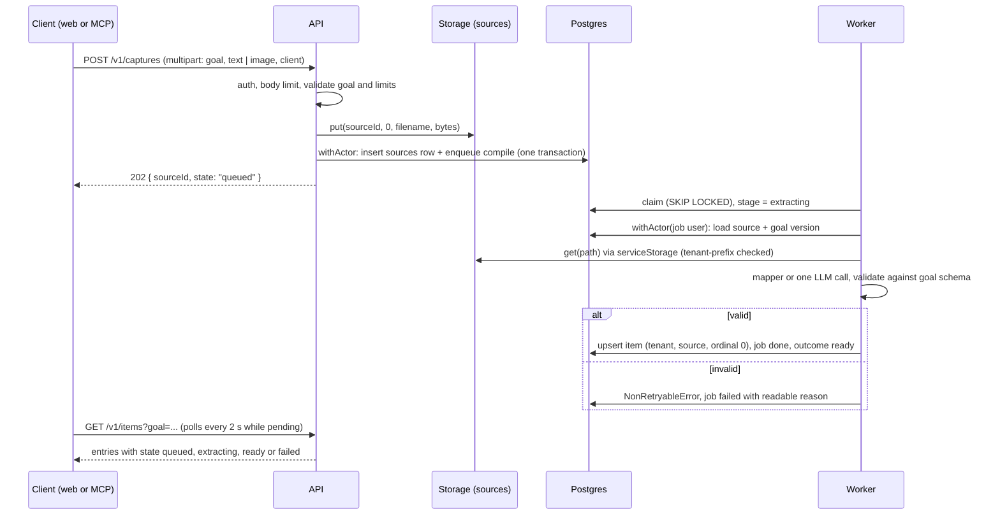
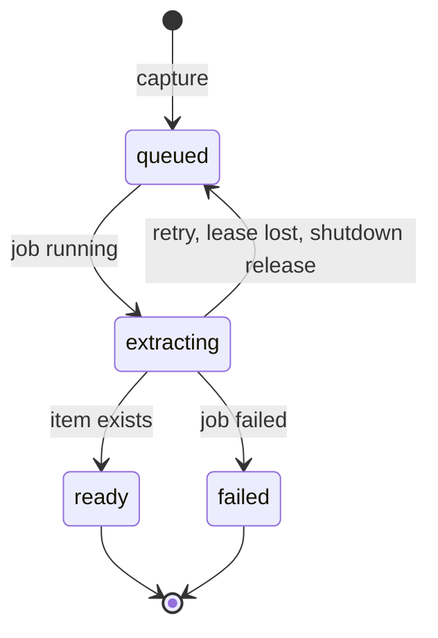
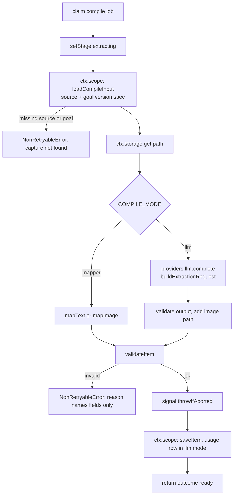

# Design Document

## 01.7-walking-skeleton

## Overview

The walking skeleton is one thin path through every layer, built on the interfaces `01.5-backend-foundation` already ships (`withActor`, `enqueue`/`claim`, `TenantStorage`, `Providers`, `defineRoute`, the error envelope). It adds:

- **Two goal files** (`apps/recipe-box/goal.json`, `apps/research-library/goal.json`) in a format that is a strict subset of the goal-engine goal file, and an API startup step that registers them as app goals owned by the `system` owner.
- **Pure domain modules in `@cauldron/core`**: the goal-file schema and item validator, the deterministic text/image mapper, the compile-state derivation, the extraction request builder, and capture limits. They have no I/O, so they are unit-tested directly and the MCP server and web-kit can share them.
- **A tenant-scoped repository in `@cauldron/core`** (`@cauldron/core/collection`) holding every SQL statement the slice needs. The API and the worker call it; neither contains SQL.
- **Six `/v1` routes** (goals, capture, source status, item list/search, item detail) declared with `defineRoute`.
- **A `compile` job handler** in the worker, mapper by default, one structured LLM call when `COMPILE_MODE=llm`.
- **Dev auth mode**: a static bearer token that stands in for a Clerk session in local development, wrapped around the existing `VerifySessionToken`.
- **`services/mcp`**: a stdio MCP server (`@modelcontextprotocol/server` v2) that calls only `/v1`.
- **Generic capture, list and detail components in `web-kit`**, mounted by Recipe Box under the existing `_auth` layout.
- **One migration** that adds what the existing schema lacks: an item ordinal for idempotent upserts, a trigram index for title search, and a job lookup index.

### Design Goals

- **Keep what later specs will keep.** Every interface is the real one; only the screens, the title search, the dev auth mode and the goal loader are expected to be replaced (requirements, Introduction).
- **Deterministic by default.** With no `OPENROUTER_API_KEY` and `COMPILE_MODE` unset, the slice runs end to end with the same output every time.
- **Tenancy stays in the database.** Every user-data statement runs inside `withActor()`. The one RLS-bypassing path is the system actor in goal registration, which already has a single permitted caller.
- **Domain logic out of the services.** SQL and rules live in `core`; the API translates HTTP to repository calls, the worker translates a job to repository calls.

### Out of Scope

As listed in the requirements: goal-engine validation and versioning, URL/PDF capture, embeddings and ranking beyond trigram title match, pages, the view-spec renderer, MCP over HTTP and OAuth, rate limits and spend caps, Research Library UI, and Railway deployment of any of this. One deployment consequence is noted under "Deferred": the API image has to contain the goal files.

### Research Findings

| Question | Finding | Effect on design |
|----------|---------|------------------|
| Which MCP SDK? | The official TypeScript SDK's stable line is v2, shipped as `@modelcontextprotocol/server` and `@modelcontextprotocol/client`. Tools use `registerTool` with a Zod 4 object schema, resources use `registerResource`, and `serveStdio(createServer)` runs stdio. Thrown handler errors become `isError` tool results. ([MCP TypeScript SDK](https://ts.sdk.modelcontextprotocol.io/v2/), [v2 server guide](https://github.com/anthropics/skills/blob/main/skills/mcp-builder/reference/node_mcp_server_v2.md)) | `services/mcp` uses v2 and the repo's existing `zod ^4`. Nothing may write to stdout except the protocol. |
| Multipart uploads through `@hono/zod-openapi` | `z.instanceof(File)` does not serialize into the OpenAPI document ([honojs/middleware#1316](https://github.com/honojs/middleware/issues/1316)). | The multipart schema declares the file part with `z.any().openapi({ type: 'string', format: 'binary' })`; the handler checks `instanceof File`. |
| JSON and multipart on one route | Two content types on one operation add risk for no gain: both clients (browser `FormData`, Node 24 global `FormData`) can send multipart. | `POST /v1/captures` accepts `multipart/form-data` only, for text and images. |
| Dev token over Storage | Storage RLS verifies Clerk-issued JWTs, so a static dev token cannot call Storage as the user. | In dev mode the API uses `serviceStorage` (secret key, tenant-prefix checked) for that principal only. See "Dev auth mode". |

Content was rephrased for compliance with licensing restrictions.

## Architecture

### System Context

```mermaid
flowchart LR
    subgraph Repo
      GF[apps/*/goal.json]
    end
    subgraph Clients
      WEB[Recipe Box SPA<br/>web-kit components]
      MCP[services/mcp<br/>stdio, spawned by Kiro]
    end
    subgraph API[services/api]
      REG[registerAppGoals<br/>at startup]
      RT[/v1 routes/]
      AUTH[resolvePrincipal<br/>+ dev token wrapper]
    end
    subgraph WK[services/worker]
      CH[compile handler]
    end
    subgraph CORE[@cauldron/core]
      PURE[goals, compile<br/>pure modules]
      COL[collection repo]
      Q[queue]
      ST[storage]
    end
    DB[(Supabase Postgres<br/>RLS)]
    BKT[(sources bucket)]
    GF --> REG --> DB
    WEB -- Clerk JWT --> AUTH
    MCP -- dev token --> AUTH
    AUTH --> RT --> COL --> DB
    RT --> ST --> BKT
    RT --> Q --> DB
    DB -. claim .-> CH
    CH --> COL
    CH --> ST
    CH --> PURE
    RT --> PURE
```

### Capture and Compile (Sequence)



### Compile State

The user-facing state is derived, never stored (01.5 design, "Job Lifecycle"). One pure function, `deriveCompileState`, is the only place the mapping lives.



| Item row | Job `status` | State | Failure reason |
|----------|--------------|-------|----------------|
| exists | any | `ready` | none |
| none | `queued` | `queued` | none |
| none | `running` | `extracting` | none |
| none | `failed` | `failed` | `failure_reason`, or "The capture could not be compiled." when null |
| none | `done` | `failed` | "The capture finished without producing an item." (should not happen; defensive) |
| none | no job found | `queued` | none (capture inserts source and job in one transaction, so this is a transient read) |

### Monorepo Changes

```
core/src/
  goals/           NEW  pure: goal-file schema, field list, item validator, LLM JSON schema, canonicalJson
  compile/         NEW  pure: mapText, mapImage, deriveCompileState, buildExtractionRequest, limits, sniffImageType
  collection/      NEW  repositories over Scoped (goals, sources, items) + createCollectionStore(db)
  db/register-goal.ts  NEW  system-scope SQL for app-goal registration, re-exported from db/system.ts
services/api/src/
  goals/register-app-goals.ts  NEW  reads apps/*/goal.json, calls registerGoal (the one allowed system-actor importer)
  auth/dev-token.ts            NEW  withDevToken(verify, { token, userId })
  routes/{goals,captures,sources,items}.ts  NEW
services/worker/src/handlers/compile.ts     NEW
services/mcp/                               NEW  stdio MCP server
web-kit/src/collection/                     NEW  client, hooks, error helper
web-kit/src/components/{capture-form,item-list,item-detail}/  NEW
apps/recipe-box/src/routes/_auth/{items.index,items.$itemId}.tsx  NEW
apps/{recipe-box,research-library}/goal.json  NEW
supabase/migrations/20261114000100_walking_skeleton.sql  NEW
.kiro/settings/mcp.json                     NEW
```

`core/package.json` gains subpath exports `./goals`, `./compile` (both isomorphic) and `./collection` (Node-only). `./db/system` keeps its single permitted importer under ESLint: `services/api/src/goals/register-app-goals.ts`. The SQL itself lives in `core/src/db/register-goal.ts`, so the registration logic is covered by `pnpm test:db` in `core` and the API module only reads files and logs.

New dependencies: `@modelcontextprotocol/server` and `@modelcontextprotocol/client` (tests) in `services/mcp`; `fast-check` as a devDependency of `core` and `services/api` (see Testing Strategy). `web-kit` gains a workspace dependency on `@cauldron/core` for the `goals` types only.

## Components and Interfaces

### Goal file (`@cauldron/core/goals`)

The file is JSON Schema-shaped so goal-engine can extend it. It carries only what the skeleton needs: name, description, icon, accent color and an object schema of string, long-text, string-list and image fields. The slug is the folder name, not a file property (goal-engine Requirement 8.3). The Zod schema is `strict()`, so a typo fails loudly. Goal-engine replaces this parser and adds views, pages and parser rules; the files written now stay valid because everything in them carries over unchanged.

```jsonc
// apps/recipe-box/goal.json
{
  "name": "Recipe Box",
  "description": "Save recipes from text or a photo and find them later.",
  "icon": "chef-hat",
  "accentColor": "#c2410c",
  "schema": {
    "type": "object",
    "titleField": "title",
    "required": ["title"],
    "properties": {
      "title":       { "type": "string", "title": "Title" },
      "ingredients": { "type": "array", "items": { "type": "string" }, "title": "Ingredients" },
      "notes":       { "type": "string", "format": "long-text", "title": "Notes" },
      "image":       { "type": "string", "format": "image", "title": "Photo" }
    }
  }
}
```

`apps/research-library/goal.json` uses `title`, `authors` (string list) and `summary` (long-text) and no image field.

```ts
// core/src/goals/index.ts (shape)
export type FieldKind = 'text' | 'long-text' | 'list' | 'image'
export interface GoalField {
  key: string
  label: string
  kind: FieldKind
  required: boolean
  isTitle: boolean
}
export const goalFileSchema: z.ZodType<GoalFile>   // strict; see refinements below
export type GoalFile = z.infer<typeof goalFileSchema>

export function goalFields(goal: GoalFile): GoalField[]            // in property order
export function validateItem(goal: GoalFile, data: unknown):
  | { ok: true; data: Record<string, unknown> }
  | { ok: false; fields: string[] }                                // keys only, never values
export function failureReasonFor(fields: string[]): string         // "The capture doesn't fit this app. Missing or invalid: title."
export function llmJsonSchema(goal: GoalFile): Record<string, unknown>  // the schema without the image field, additionalProperties: false
export function canonicalJson(value: unknown): string              // sorted keys, no whitespace
```

Refinements on `goalFileSchema`: `titleField` names a property of kind `text`; `required` keys exist; at most one image field; property keys match `^[a-z][a-zA-Z0-9]*$`; name 1 to 100 characters; description at most 200 characters (goal-engine Requirement 4.3). `validateItem` builds a strict Zod object from the field kinds: required text must be non-empty after trimming, optional fields may be absent, lists are string arrays, the image field is a string.

### Compile helpers (`@cauldron/core/compile`)

```ts
export const CAPTURE_LIMITS = {
  maxTextChars: 100_000,
  maxImageBytes: 10 * 1024 * 1024,
  imageTypes: ['image/jpeg', 'image/png', 'image/webp'] as const,
}
export function sniffImageType(bytes: Uint8Array): ImageType | null   // magic bytes: FF D8 FF, 89 50 4E 47, RIFF....WEBP
export function captureLabel(input: { text?: string; filename?: string }): string  // first line, at most 80 chars; or filename; or "Untitled capture"

export function mapText(goal: GoalFile, text: string): Record<string, unknown>
export function mapImage(goal: GoalFile, input: { filename?: string; storagePath: string }): Record<string, unknown>

export type CompileState = 'queued' | 'extracting' | 'ready' | 'failed'
export interface JobSnapshot { status: JobStatus; stage: string | null; outcome: string | null; failureReason: string | null }
export function deriveCompileState(hasItem: boolean, job: JobSnapshot | null):
  { state: CompileState; failureReason: string | null }

export type ExtractionInput =
  | { kind: 'text'; text: string }
  | { kind: 'image'; mediaType: ImageType; data: Uint8Array }
export function buildExtractionRequest(goal: GoalFile, input: ExtractionInput, model: string): CompletionRequest
```

**Text mapper rules (Requirement 3.2).** Split on `\r?\n`. The title field gets the trimmed first non-empty line. For the remaining lines: when the goal has a string-list field, lines matching `^\s*[-*]\s+(.+)$` become its items (marker removed, trimmed, order kept); every other remaining line, plus bullet lines when the goal has no list field, forms the remainder. The first long-text field gets the remainder joined with `\n`, trimmed, when non-empty. Absent optional fields stay absent. Text with no non-empty line yields no title, so validation fails on `title`.

**Image mapper (Requirement 3.3).** Title is the filename without its extension, or "Untitled photo". The goal's image field, when it has one, gets the storage path. A goal without an image field saves the item without a link; there is nowhere to put it.

**Extraction request (Requirement 5).** One system message states the task and that everything inside `<source>` is untrusted data to read, never instructions. The user message carries the source: a text part wrapped in `<source>…</source>`, or an image part plus a short text part. `output` is `{ name: 'item', jsonSchema: llmJsonSchema(goal) }`. `CompletionRequest` has no tools field, so the model gets none by construction.

### Collection repository (`@cauldron/core/collection`)

Functions take a `Scoped` and contain all SQL for the slice. `createCollectionStore(db)` wraps them in `withActor`, and is what the API depends on (as `deps.collection`), so route tests inject an in-memory fake, the same way `developerRole` is injected today.

```ts
// core/src/collection/index.ts (shape)
export interface GoalRecord {
  id: string; slug: string; name: string; description: string | null
  icon: string | null; accentColor: string | null
  version: number; spec: GoalFile
}
export interface NewCapture {
  sourceId: string            // generated by the API before upload so the storage path can use it
  goalId: string
  kind: 'text' | 'photo'
  client: 'web' | 'mcp'
  storagePath: string
  metadata: { label: string; filename?: string; contentType: string; bytes: number }
}
export interface ItemEntry {   // one row per source, newest capture first
  id: string | null           // item id; null until compiled
  sourceId: string
  title: string               // the item title, or the capture label while pending or failed
  state: CompileState
  failureReason: string | null
  capturedAt: string          // ISO 8601
}
export interface ItemRecord {
  id: string; sourceId: string; goalSlug: string; goalVersion: number
  title: string; data: Record<string, unknown>
  imagePath: string | null    // storage path found in the goal's image field, for signing
  capturedAt: string
}

export interface CollectionStore {
  listGoals(actor: RequestActor): Promise<GoalRecord[]>
  getGoal(actor: RequestActor, slug: string): Promise<GoalRecord | null>
  createCapture(actor: UserActor, input: NewCapture): Promise<{ sourceId: string; state: CompileState }>
  getSource(actor: UserActor, sourceId: string): Promise<SourceStatus | null>
  listItems(actor: UserActor, query: { goalSlug: string; q?: string; limit: number }): Promise<ItemEntry[]>
  getItem(actor: UserActor, itemId: string): Promise<ItemRecord | null>
}

// Worker-side, called inside ctx.scope():
export function loadCompileInput(scope: Scoped, sourceId: string): Promise<CompileInput | null>
export function saveItem(scope: Scoped, item: NewItem): Promise<{ itemId: string }>
export function recordCompileUsage(scope: Scoped, usage: NewUsage): Promise<void>
```

**`createCapture`** runs in one `withActor` transaction: insert the `sources` row with the caller's `sourceId`, then `enqueue(scope, { type: 'compile', payload: { sourceId }, dedupeKey: 'compile:<sourceId>' })`. A failure in either rolls both back.

**`listItems` SQL (shape).** `escapeLike` escapes `\`, `%` and `_` in `q`.

```sql
select s.id as source_id, i.id as item_id,
       coalesce(i.title, s.metadata->>'label', 'Untitled capture') as title,
       s.captured_at, i.id is not null as has_item,
       j.status, j.stage, j.outcome, j.failure_reason
from public.sources s
join public.goals g on g.id = s.goal_id and g.slug = ${goalSlug} and g.kind = 'app'
left join public.items i on i.tenant_id = s.tenant_id and i.source_id = s.id and i.ordinal = 0
left join lateral (
  select status, stage, outcome, failure_reason from public.jobs
  where tenant_id = s.tenant_id and type = 'compile' and payload->>'sourceId' = s.id::text
  order by created_at desc limit 1
) j on true
where s.tenant_id = ${tenantId}
  -- with q: i.id is not null and i.search_text ilike '%' || escapeLike(q) || '%' escape '\'
order by s.captured_at desc           -- with q: order by extensions.similarity(i.search_text, ${q}) desc, s.captured_at desc
limit ${limit}
```

Entries are keyed by source so a pending or failed capture shows up in the list (Requirement 7.2 polls on exactly these rows). A search with `q` returns only compiled items. `deriveCompileState(has_item, job)` runs in TypeScript on each row.

**`getItem`** selects by `items.id` with `tenant_id = scope.tenantId`; RLS already limits rows, the explicit predicate matches the repo convention. Another tenant's item and a missing item both return `null`, which the route turns into 404 (Requirement 6.4).

**`saveItem`**:

```sql
insert into public.items
  (tenant_id, user_id, goal_id, source_id, ordinal, goal_version, data, provenance, title, search_text)
values (${tenant}, ${user}, ${goalId}, ${sourceId}, 0, ${version}, ${data}, ${provenance}, ${title}, ${title})
on conflict (tenant_id, source_id, ordinal)
do update set goal_version = excluded.goal_version, data = excluded.data,
              provenance = excluded.provenance, title = excluded.title,
              search_text = excluded.search_text
returning id
```

Running the job twice leaves one row (Requirement 3.6). `fts` keeps its default; search fills it later.

### Goal registration

```ts
// core/src/db/register-goal.ts (exported through @cauldron/core/db/system)
export type RegisterResult = { status: 'created' | 'updated' | 'unchanged'; version: number }
export function registerGoal(scope: Scoped, input: { slug: string; spec: GoalFile }): Promise<RegisterResult>
```

Inside the caller's `withSystem` transaction:

1. `insert into goals (tenant_id, user_id, kind, slug, name, …) values ('system','system','app', …) on conflict (tenant_id, slug) do nothing`.
2. `select id, latest_version from goals where tenant_id = 'system' and slug = $1 for update`. The row lock serializes instances that start together.
3. Compare `sha256(canonicalJson(spec))` with the stored `goal_versions.content_hash` of `latest_version`. Equal: return `unchanged` and write nothing (Requirement 1.5).
4. Otherwise insert `goal_versions (version = latest + 1, schema_version 1, spec, content_hash, author 'deploy')` and update `goals` (name, description, icon, accent_color, latest_version). Status is `created` for version 1, else `updated`.

`services/api/src/goals/register-app-goals.ts`:

```ts
export interface RegistrationOutcome {
  slug: string
  status: RegisterResult['status'] | 'invalid' | 'error'
  version?: number
  errors?: { path: string; message: string }[]
}
export function registerAppGoals(opts: { db: Db; appsDir: string; logger: Logger }): Promise<RegistrationOutcome[]>
```

It lists `appsDir/*/goal.json`, reads and parses each (JSON then `goalFileSchema`), and calls `withSystem(db, (scope) => registerGoal(scope, …))`. An unreadable, malformed or invalid file logs the path and the Zod issues (`path`, `message`) and the loop continues (Requirement 1.6). A database error for one goal logs and continues too. The function never rejects. `startApi` calls it once; `RunningApi.listening` resolves after both the socket is bound and registration has finished, so a test or script that waits for `listening` sees the goals. `APPS_DIR` (default `../../apps`, relative to the working directory of `pnpm --filter api dev`) overrides the location.

The skeleton publishes a changed file as a new version and does not lock the schema once items exist. Goal-engine adds that check (its Requirement 6.3); until then, edit a goal's schema only on a database without items.

### API routes (`services/api`)

All routes are registered in `routes/index.ts` with `defineRoute`, each stating `access` explicitly, and appear in `/v1/openapi.json`. Request and response schemas are Zod, named for the OpenAPI components.

| Route | Access | Request | Success | Errors |
|-------|--------|---------|---------|--------|
| `GET /v1/goals` | `anonymous` | none | 200 `{ goals: GoalSummary[] }` | 401 (broken token), 503 |
| `GET /v1/goals/{slug}` | `anonymous` | path `slug` | 200 `GoalDetail` (summary plus `spec`, the goal file) | 404 |
| `POST /v1/captures` | `user` | multipart: `goal`, `client?`, `text?`, `image?` | 202 `{ sourceId, state: 'queued' }` | 400, 401, 413, 415 |
| `GET /v1/sources/{id}` | `user` | path `id` (uuid) | 200 `SourceStatus` | 404 |
| `GET /v1/items` | `user` | query `goal`, `q?`, `limit?` (1 to 100, default 50) | 200 `{ items: ItemEntry[] }` | 400 |
| `GET /v1/items/{id}` | `user` | path `id` (uuid) | 200 `ItemDetail` | 404 |

`GET /v1/goals` is anonymous because app goals are readable by everyone under RLS (`goals_system_read`), and the SPA and MCP server need them before or without a session. The handler filters `kind = 'app'` so a signed-in developer's drafts never appear.

```ts
const GoalSummarySchema = z.object({
  slug: z.string(), name: z.string(), description: z.string().nullable(),
  icon: z.string().nullable(), accentColor: z.string().nullable(), version: z.number().int(),
  fields: z.array(GoalFieldSchema),     // key, label, kind, required, isTitle
}).openapi('GoalSummary')
const SourceStatusSchema = z.object({
  id: z.uuid(), goal: z.string(), kind: z.enum(['text', 'photo']), client: z.enum(['web', 'mcp', 'api']),
  capturedAt: z.iso.datetime(), state: CompileStateSchema, failureReason: z.string().nullable(),
  itemId: z.uuid().nullable(),
}).openapi('SourceStatus')
const ItemDetailSchema = z.object({
  id: z.uuid(), sourceId: z.uuid(), goal: z.object({ slug: z.string(), name: z.string(), version: z.number().int() }),
  title: z.string(), state: z.literal('ready'),
  data: z.record(z.string(), z.unknown()),   // image field value replaced by a signed URL
  capturedAt: z.iso.datetime(),
}).openapi('ItemDetail')
```

**Capture handler order.** `defineRoute` attaches `requireUser()`, then the route's `bodyLimit` middleware (12 MB: the 10 MB image cap plus multipart overhead; a larger body gets 413 before it is read). The handler then:

1. Resolves `goal` against `collection.listGoals`. Unknown or missing: 400 `bad_request`, message "Unknown goal. Available goals: recipe-box, research-library.", with the slugs also in `details`.
2. Requires exactly one of `text` and `image` (400 `validation_failed` otherwise). Whitespace-only text is rejected the same way.
3. Text over 100,000 characters (`String.length`): 413 `payload_too_large`, "Text is limited to 100,000 characters."
4. Image over 10 MB: 413 `payload_too_large`, "Images are limited to 10 MB." An image whose leading bytes are not JPEG, PNG or WebP (`sniffImageType`): 415 `unsupported_media_type`, "Images must be JPEG, PNG or WebP." The declared part type is not trusted.
5. Generates `sourceId = randomUUID()`, uploads the raw bytes with `storage.put(sourceId, 0, filename, bytes, contentType)` (text as `capture.txt`, `text/plain; charset=utf-8`), then calls `collection.createCapture`. Upload comes first: an orphaned object after a failed insert is harmless, while a source row pointing at nothing would fail its compile.

Nothing is stored or queued before steps 1 to 4 pass (Requirement 2.3). `client` defaults to `web`; it is a self-declared label for display and later analytics, not a security attribute.

**New error codes.** `ErrorCode` gains `payload_too_large` and `unsupported_media_type`, with their statuses added to the existing switch in `errors.ts` for non-`ApiError` HTTP exceptions (413, 415). Codes are only ever added (01.5 design, "error envelope").

**Item detail signing.** `getItem` returns `imagePath`; the handler calls `storage.signedReadUrl(path, 300)` (the API clamps to at most 600 s) and replaces the image field's value in `data` with the URL, so the generic renderer needs no second request.

**Storage selection.** `ApiDeps` gains `collection: CollectionStore` and `storageFor(principal, bearer): TenantStorage`. Production's `storageFor` returns `userStorage(cfg, async () => bearer, tenantId)` for Clerk sessions and `serviceStorage(cfg, tenantId)` when `principal.sessionId === DEV_SESSION_ID`. Tests inject an in-memory `TenantStorage`.

### Dev auth mode (`services/api/src/auth/dev-token.ts`)

```ts
export const DEV_SESSION_ID = 'dev'     // Clerk session IDs start with "sess_", so this can't collide
export interface DevTokenOptions { token: string; userId: string }
export function withDevToken(verify: VerifySessionToken, opts: DevTokenOptions): VerifySessionToken
```

The returned verifier compares the presented token with `opts.token` by hashing both with SHA-256 and calling `crypto.timingSafeEqual` on the digests (fixed length, so length is not leaked). A match yields `{ sub: opts.userId, sid: DEV_SESSION_ID }`; anything else goes to the wrapped Clerk verifier unchanged (Requirement 8.2). `resolvePrincipal`, `defineRoute` and every route are untouched: the dev user is an ordinary `Principal` with `tenantId === userId`, so RLS behaves exactly as for a Clerk session (Requirement 8.7).

**Configuration and guards.** `services/api/src/env.ts` gains optional `AUTH_MODE` (`clerk` | `dev`), `DEV_API_TOKEN`, `DEV_USER_ID`, `SUPABASE_SECRET_KEY`, `NODE_ENV`, `RAILWAY_ENVIRONMENT` and `APPS_DIR`, plus a `devAuthRules` refinement chained after `providerRules`:

- `AUTH_MODE=dev` requires `DEV_API_TOKEN`, `DEV_USER_ID` and `SUPABASE_SECRET_KEY`, and `DEV_API_TOKEN` of at least 32 characters. Violations name the variable through the existing `EnvError` (Requirement 8.4). `SUPABASE_SECRET_KEY` is needed only for the dev principal's storage access.
- `checkAuthMode(env)`, called first in `startApi` next to `checkEmbeddingDimensions`, throws `StartupError("AUTH_MODE=dev can't run while NODE_ENV=production or RAILWAY_ENVIRONMENT is set. Unset AUTH_MODE, or run locally.")` (Requirement 8.3). `Dockerfile.service` already sets `NODE_ENV=production`, and Railway sets `RAILWAY_ENVIRONMENT`, so a deployed image cannot start in dev mode.
- With `AUTH_MODE` unset or `clerk`, `createSessionTokenVerifier` is used as is (Requirement 8.5).
- Startup logs `warn: "dev auth mode is active: a static token acts as DEV_USER_ID"`. `DEV_API_TOKEN` and `SUPABASE_SECRET_KEY` are added to `REDACT_PATHS` (Requirement 8.6).

### Compile handler (`services/worker/src/handlers/compile.ts`)

`createCompileHandler({ mode })` returns a `JobHandler` for payload `{ sourceId }`. The registry in `handlers/index.ts` becomes `createHandlers({ compileMode })`; the existing exported `handlers` stays and uses `mapper`. `startWorker` builds the registry from `env.COMPILE_MODE` (`mapper` default, or `llm`; unknown values fail `EnvError` naming `COMPILE_MODE`).



- **Tenant boundary.** `ctx.scope` is the job user's `withActor`; `ctx.storage` is `serviceStorage` bound to the job's tenant, so a path outside the tenant throws before Storage is contacted (Requirement 3.1). The handler never sees the `Db`.
- **Idempotency (Requirement 3.6).** `saveItem` upserts on `(tenant_id, source_id, ordinal)`. In `llm` mode the usage row uses `idempotency_key = 'compile:<sourceId>'` with `on conflict do nothing`, the same pattern as `reembed`, so a retry records spend once. A worker that lost its lease can only rewrite the same row; in mapper mode the content is identical, in LLM mode the last writer wins.
- **Failures.** Validation failure throws `NonRetryableError(failureReasonFor(fields))`. The reason lists field keys only, never source text. `ProviderError` and storage errors are retryable and use the queue's backoff; after three attempts the job is `failed` with "failed after 3 attempts".
- **LLM mode.** One `providers.llm.complete({ ...buildExtractionRequest(goal, input, providers.models.compile), signal: ctx.signal })`. The output is validated with `validateItem` before saving. For a photo into a goal with an image field, the handler sets that field to the storage path after validation of the model output, because the model never sees paths. Provenance records `{ mode, model }`. With `PROVIDERS=mock`, the recording store replays; an unrecorded request fails the test.
- **Provenance.** `provenance = { mode: 'mapper' | 'llm', sourceKind, model? }`.

### MCP server (`services/mcp`)

A pnpm workspace package, `"type": "module"`, run with `tsx --env-file-if-exists=../../.env.local src/index.ts` (the same convention as the other services; no build step, since only Kiro launches it). Entry point `serveStdio(createServer)`. Logs go to stderr only.

```ts
// services/mcp/src/api.ts (shape)
export interface ApiClient {
  get<T>(path: string, query?: Record<string, string>, signal?: AbortSignal): Promise<T>
  postForm<T>(path: string, form: FormData, signal?: AbortSignal): Promise<T>
}
export function createApiClient(opts: { baseUrl: string; token: string; fetch?: typeof fetch }): ApiClient
export class ApiToolError extends Error { constructor(readonly code: string, message: string) }
```

- **Startup (Requirement 9.2).** `parseEnv` from `@cauldron/core/env` over `API_BASE_URL` (URL) and `DEV_API_TOKEN` (non-empty); on `EnvError` it writes the message to stderr and exits 1.
- **Errors (Requirement 9.8).** A non-2xx response with an envelope becomes `ApiToolError(error.code, error.message)`, shown to the model as `[code] message`. A network failure becomes "Could not reach the API at <API_BASE_URL>." The `Authorization` header is set inside `createApiClient` only, and no error path formats the request.
- **Goal resolution (Requirement 9.4).** `resolveGoal(goals, text)`: exact slug, else exact name, both case-insensitive. No match throws `ApiToolError('not_found', 'No goal matches "x". Available goals: recipe-box (Recipe Box), …')`.

| Tool | Input | Calls | Result |
|------|-------|-------|--------|
| `list_goals` | none | `GET /v1/goals` | structured `{ goals }`, text: one line per goal with fields |
| `capture` | `goal`, `text?` or `imagePath?` (exactly one) | `GET /v1/goals`, `POST /v1/captures` with `client=mcp` | `{ sourceId, state }`, text: "Saved. Compile state: queued." |
| `search` | `goal`, `query`, `limit?` | `GET /v1/items?goal&q&limit` | structured `{ items }`, text: count and titles with state |
| `get_item` | `id` | `GET /v1/items/{id}` | structured item (image field is a signed URL), text: title and fields |

Resource `examples://goals/recipe-box` (`application/json`) returns `spec` from `GET /v1/goals/recipe-box`. A `ResourceNotFoundError` covers a 404.

**Image capture checks (Requirement 9.6).** Before any request: `stat` the path (must be a regular file, at most `CAPTURE_LIMITS.maxImageBytes`), read it, run `sniffImageType` from `@cauldron/core/compile`. Any failure throws an error naming the problem and sends nothing. Limits and sniffing come from the shared pure module so the MCP server and the API cannot drift.

**Kiro configuration (Requirement 9.9).** `.kiro/settings/mcp.json`:

```json
{
  "mcpServers": {
    "cauldron": {
      "command": "pnpm",
      "args": ["--silent", "--filter", "mcp", "start"],
      "env": { "API_BASE_URL": "http://localhost:8787" }
    }
  }
}
```

`DEV_API_TOKEN` is deliberately not in the file: the `start` script loads the gitignored repo-root `.env.local`, so Kiro needs no shell variable and a missing shell variable cannot override the file with a literal `${...}`. The command assumes Kiro runs workspace configs from the repo root; the first task verifies this and adds `--dir` if not.

### web-kit and Recipe Box

`web-kit` gains a plain-fetch data layer (TanStack Query arrives with public-api-sdk, 01.5 design "Out of Scope") and three components, exported through `./collection` and `./components`.

```ts
// web-kit/src/collection/client.ts
export class ApiRequestError extends Error { constructor(message: string, readonly code: string | null, readonly status: number) }
export interface CollectionClient {
  getGoal(slug: string): Promise<GoalDetail>
  capture(input: { goal: string; text?: string; image?: File }): Promise<{ sourceId: string; state: CompileState }>
  listItems(query: { goal: string; q?: string }): Promise<ItemEntry[]>
  getItem(id: string): Promise<ItemDetail>
}
export function createCollectionClient(apiFetch: ApiFetch): CollectionClient   // apiFetch is useApiClient(baseUrl)'s result
export function useCollectionClient(baseUrl: string): CollectionClient        // memoized

// web-kit/src/collection/hooks.ts
export function useGoal(client, slug): AsyncState<GoalDetail>
export function useItems(client, goal, q, opts?: { pollMs?: number }): AsyncState<ItemEntry[]> & { refresh(): void }
export function useItem(client, id): AsyncState<ItemDetail>
```

`createCollectionClient` turns every non-2xx response into `ApiRequestError` whose `message` is the envelope's `error.message` (Requirement 7.5), falling back to "Request failed (status)." when the body is not an envelope. `useItems` refetches every `pollMs` (default 2000) while any entry is `queued` or `extracting`, and stops when none are, clearing its timer on unmount (Requirement 7.2). Search input is debounced by 250 ms in the list component.

| Component (`web-kit/src/components/<name>/index.tsx`) | Props | Behavior |
|-----|-------|----------|
| `CaptureForm` | `client`, `goal`, `onCaptured(sourceId)` | Text area and one image picker (`accept="image/jpeg,image/png,image/webp"`). Submits `FormData`. Disabled while sending; shows the error `message` in `role="alert"`; clears on success. |
| `ItemList` | `client`, `goal`, `renderLink(entry, children)` | Search box, rows of title, state badge and failure reason, `useItems` polling. Rows with `state === 'ready'` render through `renderLink` so the app supplies its router `Link`; web-kit does not depend on TanStack Router. |
| `ItemDetail` | `client`, `itemId` | Loads the goal's fields and the item, renders each field by `kind`: `text` as a paragraph, `long-text` as `whitespace-pre-wrap`, `list` as `<ul>`, `image` as ``; labels from `GoalField.label`. No recipe-specific code. |

All use Tailwind semantic tokens (`bg-background`, `text-muted-foreground`, `border`) and `cn()`, per the style steering.

Recipe Box adds `src/lib/goal.ts` (`export const GOAL_SLUG = 'recipe-box'`, the slug bundled at build time, goal-engine Requirement 8.8) and two routes under the pathless `_auth` layout, so signed-out visitors are redirected to `/sign-in` by the existing guard (Requirement 7.7):

- `routes/_auth/items.index.tsx` (`/items`): `CaptureForm` above `ItemList`; a successful capture calls `refresh()`.
- `routes/_auth/items.$itemId.tsx` (`/items/$itemId`): `ItemDetail`.

The home page gains a link to `/items`, and its snapshot is updated deliberately.

## Data Models

### Migration `supabase/migrations/20261114000100_walking_skeleton.sql`

```sql
-- Walking skeleton additions (spec 01.7-walking-skeleton). Additive only.
-- One item per (source, ordinal): lets the compile job upsert, so a retry or a
-- re-run leaves one item. The skeleton always uses ordinal 0; capture-compile
-- can use higher ordinals for several items from one source.
alter table public.items
  add column ordinal int not null default 0 check (ordinal >= 0);
alter table public.items
  add constraint items_tenant_source_ordinal_key unique (tenant_id, source_id, ordinal);

-- Title search (Requirement 6.2): ilike '%q%' and similarity() both use trigrams.
create index items_search_text_trgm on public.items
  using gin (search_text extensions.gin_trgm_ops);

-- Latest compile job for a source (Requirements 4.1, 6.1).
create index jobs_compile_source on public.jobs
  (tenant_id, (payload->>'sourceId'), created_at desc)
  where type = 'compile';
```

No grant or policy changes: `authenticated` already holds select, insert and update on `items` and `sources`, select and insert on `jobs`, and the `goals_system_read` and `goal_versions_system_read` policies already let a user and the worker read app goals. The existing `items_tenant_source` index becomes redundant with the new unique constraint and is left alone (migrations never edit applied ones; dropping it is a separate decision).

### Rows written by the slice

| Table | Written by | Notes |
|-------|-----------|-------|
| `goals` | `registerGoal` (system) | `kind 'app'`, `tenant_id 'system'`, `slug` = folder name, `latest_version` set after the first version row |
| `goal_versions` | `registerGoal` (system) | `spec` = the goal file, `content_hash` = SHA-256 of `canonicalJson(spec)`, `author 'deploy'` |
| `sources` | `createCapture` (user) | `kind 'text'` or `'photo'`, `storage_paths = [path]`, `client`, `metadata { label, filename?, contentType, bytes }` |
| `jobs` | `enqueue` (user) | `type 'compile'`, `payload { sourceId }`, `dedupe_key 'compile:<sourceId>'`, `stage 'extracting'` while running, `outcome 'ready'` when done |
| `items` | `saveItem` (job user) | `ordinal 0`, `data` per goal schema, `title` and `search_text` from the title field, `goal_version` = latest at compile time |
| `usage` | compile handler, `llm` mode only | `operation 'compile'`, `idempotency_key 'compile:<sourceId>'` |

### Storage layout

Raw sources use the existing `{tenantId}/{sourceId}/{index}-{safeFilename}` layout: text at `…/0-capture.txt`, a photo at `…/0-<sanitized filename>`. Objects are never overwritten (`upsert: false`).

### Environment variables

Added to `.env.example` (Requirement 10.2):

| Variable | Used by | Required | Notes |
|----------|---------|----------|-------|
| `AUTH_MODE` | api | no | `dev` enables the static token. Local only: the API refuses to start with it when `NODE_ENV=production` or `RAILWAY_ENVIRONMENT` is set |
| `DEV_API_TOKEN` | api, mcp | when `AUTH_MODE=dev`; always for mcp | **Local-only secret.** At least 32 characters, for example `openssl rand -hex 32` |
| `DEV_USER_ID` | api | when `AUTH_MODE=dev` | The Clerk user ID of the developer, so MCP captures appear in Recipe Box (Requirement 8.7) |
| `SUPABASE_SECRET_KEY` | api | when `AUTH_MODE=dev` | Already used by the worker. The API uses it only for the dev principal's Storage access |
| `APPS_DIR` | api | no | Directory holding `*/goal.json`. Default `../../apps` |
| `COMPILE_MODE` | worker | no | `mapper` (default) or `llm` |
| `API_BASE_URL` | mcp | yes | Example `http://localhost:8787` |

## Correctness Properties

*A property is a characteristic or behavior that should hold true across all valid executions of a system-essentially, a formal statement about what the system should do. Properties serve as the bridge between human-readable specifications and machine-verifiable correctness guarantees.*

Only the pure modules have properties: the goal file, the mapper, validation, state derivation, request building, escaping, the dev-token wrapper and goal resolution. Routes, SQL, storage, the worker loop and the screens have no "for all inputs" statement worth 100 iterations, so they use example and integration tests (see Testing Strategy).

Reflection on the prework: the failure-reason check (3.5) and the validity check share one function, so they form one property. The state-derivation criteria 4.1 and 4.2 form one property. 5.1 and 5.4 both describe the extraction request and form one property. 8.1, 8.2 and 8.7 form one property about the dev verifier. Each remaining property validates a different function.

### Property 1: Canonical JSON round trip and key-order invariance

*For any* JSON value, `JSON.parse(canonicalJson(v))` is deeply equal to `v`, and *for any* permutation of the key order at every object level, `canonicalJson` returns the same string, so the SHA-256 content hash of a goal file does not change when only its key order changes.

**Validates: Requirements 1.5**

### Property 2: Goal file round trip

*For any* valid goal file, parsing the result of `JSON.stringify` with `goalFileSchema` succeeds and yields a value deeply equal to the original, and `goalFields` returns one field per property in property order with exactly one `isTitle` field.

**Validates: Requirements 1.3, 1.4**

### Property 3: Image type detection follows the leading bytes

*For any* byte string that starts with the JPEG, PNG or WebP signature followed by any suffix, `sniffImageType` returns that type, and *for any* byte string that starts with none of the three signatures, it returns `null`.

**Validates: Requirements 2.3, 9.6**

### Property 4: Text mapper keeps every line and the title rule

*For any* text and *for any* goal with a title field and optionally a string-list field and a long-text field: if the text has a non-empty line, the title field equals the trimmed first non-empty line, otherwise it is absent; every later non-empty trimmed line appears in exactly one of the list field (when the goal has one and the line is a `-` or `*` bullet) or the long-text field (when the goal has one), with list items in source order; and mapping the same input twice gives equal output.

**Validates: Requirements 3.2**

### Property 5: Item validation accepts exactly the schema and reports only field keys

*For any* goal and *for any* candidate data object, `validateItem` returns `ok` if and only if every required field is present with the right type and no key outside the schema is present, and when it returns not-ok its `fields` are a non-empty subset of the goal's property keys, and `failureReasonFor(fields)` mentions no text other than those keys and fixed wording.

**Validates: Requirements 3.5**

### Property 6: Compile state is derived from the item and the job

*For any* item-presence flag and *for any* job snapshot or absence of one, `deriveCompileState` returns a state in `{queued, extracting, ready, failed}`; the state is `ready` if and only if an item is present; without an item it is `queued` for a queued or absent job, `extracting` for a running job and `failed` for a failed or done job; and `failureReason` is non-null if and only if the state is `failed`.

**Validates: Requirements 4.1, 4.2**

### Property 7: The extraction request carries the goal schema and isolates the source

*For any* goal and *for any* source text, `buildExtractionRequest` produces a request whose output schema is `llmJsonSchema(goal)` (the goal's properties without the image field, `additionalProperties: false`), whose system message does not contain the source text, whose source text appears only inside a `<source>` block of the user message, and which has no field that grants the model tools.

**Validates: Requirements 5.1, 5.4**

### Property 8: LIKE escaping round trip

*For any* search string `q`, unescaping `escapeLike(q)` (removing each backslash that precedes `\`, `%` or `_`) returns `q`, and the escaped string contains no unescaped `%` or `_`.

**Validates: Requirements 6.2**

### Property 9: The dev token authenticates only the exact token

*For any* presented token string `t` and *for any* configured dev token `d` and user ID `u`, `withDevToken(verify, { token: d, userId: u })(t)` resolves to `{ sub: u, sid: 'dev' }` without calling `verify` if and only if `t === d`; for every other `t` it calls `verify` exactly once with `t` and returns or rethrows its result unchanged.

**Validates: Requirements 8.1, 8.2, 8.7**

### Property 10: Goal resolution by slug or name

*For any* list of goals with distinct slugs and names and *for any* member, resolving its slug or any upper/lower-case variant of its slug or name returns that goal; *for any* string that matches no goal slug or name case-insensitively, resolution fails with an error that lists every available slug.

**Validates: Requirements 9.4**

## Error Handling

| Situation | Behavior |
|-----------|----------|
| Goal file unreadable, malformed JSON or fails `goalFileSchema` | Logged with file path and Zod `path`/`message` pairs; that goal skipped; other goals and the API start (Requirement 1.6) |
| Database error registering one goal (for example a duplicate goal name) | Logged with slug; other goals continue; startup does not fail |
| Capture names no goal or an unknown goal | 400 `bad_request`, message lists available slugs, same slugs in `details`; nothing stored (Requirement 2.2) |
| Capture has neither or both of `text` and `image`, or whitespace-only text | 400 `validation_failed` |
| Text over 100,000 characters, image over 10 MB, or body over the 12 MB cap | 413 `payload_too_large`, message names the limit; nothing stored or queued (Requirement 2.3) |
| Image bytes are not JPEG, PNG or WebP | 415 `unsupported_media_type`, message names the types |
| Storage upload fails | 500 `internal` with the generic message; no source row, no job |
| Insert or enqueue fails after upload | Transaction rolls back; the uploaded object is orphaned and logged with its path. Raw sources are immutable and cheap, so no delete is attempted |
| `GET /v1/items` for an unknown goal | 400 `bad_request` listing slugs |
| Item or source belongs to another tenant, or does not exist | 404 `not_found` (Requirement 6.4); RLS makes the two cases identical to the caller |
| Non-UUID item or source ID | 400 `validation_failed` from the path schema, before any SQL |
| Source or goal version missing when the worker runs | `NonRetryableError("The capture could not be found.")`; job `failed` |
| Mapped or extracted data fails validation | `NonRetryableError` with a reason naming field keys only; job `failed`; state `failed` (Requirement 3.5) |
| Storage read fails, or `ProviderError` in LLM mode | Retryable; queue backoff up to 3 attempts; then `failed` with "failed after 3 attempts" |
| Handler runs after a lost lease | `ctx.signal` aborts; `signal.throwIfAborted()` runs before the write; a late write rewrites the same item (upsert) |
| `AUTH_MODE=dev` with a missing or short setting | `EnvError` naming `DEV_API_TOKEN`, `DEV_USER_ID` or `SUPABASE_SECRET_KEY`; exit 1 (Requirement 8.4) |
| `AUTH_MODE=dev` with `NODE_ENV=production` or `RAILWAY_ENVIRONMENT` | `StartupError` naming both variables; exit 1 before any connection (Requirement 8.3) |
| Wrong token in dev mode | Falls through to Clerk verification, then the normal 401 |
| MCP missing `API_BASE_URL` or `DEV_API_TOKEN` | `EnvError` on stderr naming them; exit 1 (Requirement 9.2) |
| MCP image path unreadable, wrong type or too large | Tool error before any request (Requirement 9.6) |
| API returns an error envelope to the MCP server | Tool error `[code] message`; the token never appears in a message (Requirement 9.8) |
| API unreachable from the MCP server | Tool error "Could not reach the API at <API_BASE_URL>." |
| Web request fails | `ApiRequestError`; the component shows the envelope's `message` in `role="alert"` (Requirement 7.5) |

## Testing Strategy

Follows the testing steering: Vitest, `vitest --run`, co-located tests, no network, no OpenRouter, Clerk faked at its boundary, real Postgres for `*.db.test.ts`.

### Property-based tests

The steering allows property tests when a design defines correctness properties; this design defines Properties 1 to 10, all over pure functions, so PBT fits them and nothing else.

- Library: **fast-check**, added as a devDependency of `core` (Properties 1 to 8), `services/api` (Property 9) and `services/mcp` (Property 10). Not implemented from scratch.
- Each property is one `fc.assert(fc.property(...), { numRuns: 100 })` test, at least 100 runs.
- Each test carries the tag comment `// Feature: 01.7-walking-skeleton, Property N: <property text>`.
- Generators: a `goalFileArb` that builds valid goal files (1 to 6 properties, one title string, optional list, long-text and image fields, valid key names) feeds Properties 2, 4, 5 and 7; `fc.string()` with extra weight on newlines, `-`/`*` bullets and whitespace feeds Property 4; `fc.uint8Array()` with the three magic prefixes feeds Property 3; `fc.jsonValue()` and a key-shuffling helper feed Property 1.

### Unit and example tests (`pnpm test`, no database)

| Area | Tests |
|------|-------|
| `core/goals` | Real `apps/recipe-box/goal.json` and `apps/research-library/goal.json` parse, have different schemas, and have a title field (Requirements 1.1, 1.2). Refinement failures: missing `titleField`, two image fields, unknown key. |
| `core/compile` | `mapImage` with and without extension, without filename, with and without an image field (3.3). `captureLabel` truncation. `buildExtractionRequest` snapshot for one text and one image goal. |
| `services/api` routes, via `createApp(deps)` and `app.request()` | Fake token verifier, in-memory `CollectionStore`, in-memory `TenantStorage`. Every new operation in `/v1/openapi.json` declares `security`; `GET /v1/goals` and `GET /v1/goals/{slug}` are `[]`, the rest require a bearer token. 401 without a token and with a broken token on the anonymous goals routes. Capture: happy paths for text and image (the stored bytes equal the sent bytes, path starts with the tenant), unknown goal, both/neither input, 100,000 versus 100,001 characters, 10 MB versus 10 MB + 1, a `.png`-named text file, and for every rejection the fake store and storage are untouched (2.1 to 2.4). Item detail returns a URL with expiry at most 600 s in the image field (6.3); a null repository result gives a 404 envelope (6.4). Error envelope `code` values are stable, including the two new ones. CORS still allows only `APP_ORIGINS` for a multipart preflight. |
| `services/api` registration | `registerAppGoals` over a temp directory: valid, malformed JSON and schema-invalid files; the valid goal registers, the others log their path and issues, the function resolves (1.4, 1.6). |
| `services/api` dev auth | `loadEnv` cases per variable, 31 versus 32 character token (8.4). `checkAuthMode` with `NODE_ENV=production` and with `RAILWAY_ENVIRONMENT` (8.3). With `AUTH_MODE` unset, the dev token string gets 401 (8.5). With dev mode on, the principal's `tenantId` equals `DEV_USER_ID` (8.7). A captured logger sees the startup warning and never the token (8.6). |
| `services/worker` | `createHandlers` registers `compile`; `COMPILE_MODE` parsing (`mapper`, `llm`, invalid names the variable). Handler with a provider that fails the test if called, in default mode (5.2). |
| `services/mcp`, fake `fetch` | Tool and resource listing (9.3); `capture` text and image send `client=mcp` and return ID and state (9.5); bad image path, missing path and oversize send nothing (9.6); `search` and `get_item` return structured content and text (9.7); a 404 envelope and a thrown network error become tool errors that never contain the token (9.8); env failure names both variables (9.2). The server is exercised through the SDK client over an in-memory or stdio transport; the first task picks whichever v2 supports. |
| `web-kit` | `createCollectionClient`: envelope message and non-envelope fallback (7.5), `FormData` shape on capture. `useItems` with fake timers: refetches every 2 s while a row is `queued` or `extracting`, stops when none is, no timer after unmount (7.2). `CaptureForm` (7.1), `ItemList` search debounce (7.3) and `ItemDetail` rendering one field of each kind with a snapshot (7.4), all with React Testing Library and a fake client. |
| `apps/recipe-box` | Routing tests for `/items` and `/items/x` redirect to `/sign-in` when signed out (7.7). Home snapshot updated for the new link. |

### Database integration tests (`pnpm test:db`)

Use `asUser` / `asAnon` / `asSystem` from `core/src/db/testing.ts`, rolled back per test, real Postgres, no mocks.

- `core`, `registerGoal`: first call creates version 1; the same file again returns `unchanged` and leaves one `goal_versions` row; a changed file creates version 2; a reordered-keys file is `unchanged` (Requirement 1.5). `GET`-shaped read of app goals as anon works.
- `core`, collection repository: `createCapture` inserts one source and one `compile` job in one transaction, and a failing enqueue leaves no source (2.4, 2.5). `listItems` returns pending, failed and ready entries newest first with derived states, and `q` matches case-insensitively and orders by similarity, including `%` and `_` in the query (6.1, 6.2). Cross-tenant: user B's `getItem`, `getSource` and `listItems` see nothing of user A's, so the route returns 404 (6.4, 6.5). `saveItem` twice leaves one row and `search_text` equals the title (3.6, 3.7).
- `core`, migration: the new constraint rejects a second item at the same `(tenant, source, ordinal)`.
- `services/worker`, `compile.db.test.ts`: with a real source and a draft goal owned by the test user (same approach as `reembed.db.test.ts`), run the handler on a text source and a photo source with a fake `TenantStorage`; assert one item, outcome `ready`, `search_text`; run it twice and assert one item; run it on text with no non-empty line and assert `NonRetryableError` naming `title`; give it a storage path in another tenant and assert it throws before any read (3.1, 3.4 to 3.6). In `llm` mode with a memory recording store: one provider call, one `usage` row after two runs, and an invalid recorded output fails the job (5.1, 5.3, 5.5).

### Smoke and manual checks

- `scripts/smoke-production.sh` is unchanged; this slice is local only.
- Parse `.kiro/settings/mcp.json` in a unit test and assert it holds no token value (9.9).
- **Manual check (Requirement 10.4).** With `pnpm db:start`, `.env.local` set (`AUTH_MODE=dev`, `DEV_API_TOKEN`, `DEV_USER_ID` = your Clerk user ID, `PROVIDERS=mock`) and `pnpm dev:stack` running:
  1. Sign in to Recipe Box, open `/items`, paste a recipe with a title line and `-` bullets, and see the row go `queued` to `ready` within 5 s.
  2. Upload a JPEG. See it `ready`, open it, and see the photo on the detail page.
  3. Type part of a title in the search box; see only matching items.
  4. In Kiro, call the `cauldron` `capture` tool with text; see the item appear in Recipe Box.
  5. Call `search` with part of its title and see it returned.

The verification commands after code changes are `pnpm typecheck`, `pnpm lint`, `pnpm test`, `pnpm build`, and `pnpm test:db` because this work touches a migration, RLS-protected queries and the queue.

## Requirements Traceability

| Requirement | Where it is met |
|-------------|-----------------|
| 1 Goal files | Goal file; Goal registration; `GET /v1/goals`; Properties 1, 2 |
| 2 Capture | `POST /v1/captures`; `createCapture`; Storage layout; Property 3 |
| 3 Deterministic compile | Compile helpers; Compile handler; `saveItem`; Properties 4, 5 |
| 4 Compile status | Compile State; `deriveCompileState`; `GET /v1/sources/{id}`; Property 6 |
| 5 Optional LLM extraction | Extraction request; Compile handler LLM mode; Property 7 |
| 6 List, view, search | Collection repository; `GET /v1/items`, `GET /v1/items/{id}`; Property 8 |
| 7 Recipe Box screens | web-kit and Recipe Box |
| 8 Dev auth mode | Dev auth mode; Property 9 |
| 9 Local MCP server | MCP server; Property 10 |
| 10 Run and verification | Environment variables; Testing Strategy; manual check |

## Design Decisions and Rationale

1. **Repository in `core`, injected into the API as `CollectionStore`.** The structure steering keeps domain logic out of services, the testing steering has API tests run in-process with fakes, and the worker needs the same item write. One repository gives the database tests a home in `core` where the harness lives.
2. **Registration SQL in `core/src/db/register-goal.ts`.** The ESLint rule allows exactly one importer of the system actor. Putting the SQL behind `@cauldron/core/db/system` keeps that rule intact and lets `pnpm test:db` in `core` cover idempotency with the rollback harness.
3. **Dev auth wraps `VerifySessionToken` instead of changing `resolvePrincipal`.** One new file, no change to routes or `defineRoute`, and the dev user is an ordinary principal under RLS. The cost is the `DEV_SESSION_ID` marker the storage factory reads.
4. **Dev principal uses `serviceStorage`; Clerk principals keep `userStorage`.** Storage RLS cannot verify a static token. The secret key stays out of the API unless `AUTH_MODE=dev` is set, which the production guards forbid. The tenant-prefix check still bounds every path.
5. **List rows are keyed by source, not item.** A pending or failed capture has no item, yet Requirements 6.1 and 7.2 need it in the list. `id` is null until compiled.
6. **`items.ordinal` rather than a unique `(tenant, source)` index.** The unique `(tenant_id, source_id)` index would block capture-compile's multiple items per source. `ordinal` gives upsert now and leaves that door open.
7. **Multipart only for capture.** One content type, one code path, both clients already build `FormData`. Text in a form field is a small cost for the simplicity.
8. **Trimmed title-only search.** `ilike` plus `similarity()` over `search_text` is what Requirement 6.2 asks for and what search will replace. `fts` and `embedding` stay empty.
9. **No TanStack Query yet.** Two small hooks with a polling timer cover the three screens; public-api-sdk owns the real data layer.
10. **MCP server on SDK v2 with stdio and `tsx`.** v2 is the stable line. Kiro is the only launcher, so there is no build, matching the services' `dev` scripts.
11. **Shared pure limits and image sniffing.** `@cauldron/core/compile` holds the 100,000-character and 10 MB limits and the magic-byte check, so the API, the MCP server and tests agree.

### Deferred

- The API image (`Dockerfile.service`) copies only `dist/`, so a deployed API would find no goal files. Deployment is out of scope here; goal-engine or the Railway work must copy `apps/*/goal.json` into the image and set `APPS_DIR`.
- Capture-time rejection of a photo into a goal with no image field. The skeleton saves the item without an image link.
- A schema lock once items exist (goal-engine Requirement 6.3). Until then, changing a goal's schema on a database that has items can leave older items that no longer fit.
