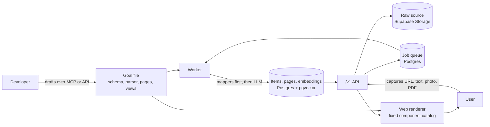

# Cauldron

Cauldron is a skeleton for building "save it and find it later" apps. Each app is defined by one goal file. Recipe Box and Research Library are two apps built on it.

Cauldron is being built with Kiro for Kiroween 2026, in the Skeleton Crew category.

> **Status:** in development for Kiroween 2026. Nothing is deployed yet. The foundation spec (monorepo, Recipe Box app shell, Clerk sign-in, Railway deploy config) is partly built. Sections marked *planned* describe what the specs call for, not working features.

## The pitch

Most of us save links we never find again. Recipes end up in screenshots and bookmarks, and articles pile up in read-later apps. With Recipe Box, you paste a link, text, photos or a PDF, and Cauldron pulls out the ingredients, steps and timings. Research Library does the same for articles, pulling out the summary, key points and topics, and groups them into topic pages. Every field links back to where it came from in the source. Search by meaning, even from a vague memory like "that piece about on-device models from last month."

**Who it's for:**
- **Home cooks** who want saved recipes in one clean, searchable place, with a step-by-step Cooking Mode.
- **Students and researchers** who collect articles, papers and PDFs and need to find and cite them later.
- **Developers** who want their own collection app, like a gear list, travel planner or reading log. Fork the skeleton, write a goal file, and get capture, extraction, search and screens for free. Or use the hosted API and MCP server instead.

**For the Skeleton Crew judges:** Recipe Box and Research Library look like separate apps, but each one is just a goal file, a thin entry point and one custom view. In the video, Kiro creates a third goal over MCP, and it renders without any new code.

## The two apps

Both apps sit on the same skeleton. Each app folder contains only its goal file, a thin web entry point and one custom view, and each app shows exactly one goal.

- **Recipe Box** (`apps/recipe-box`, planned). Captures recipes into structured `Recipe` items with servings, timings, ingredients and steps, grouped by cuisine. Its custom view is **Cooking Mode**: one step at a time, with step timers and voice "next".
- **Research Library** (`apps/research-library`, planned). Captures articles, arXiv papers and PDFs into `Article` items with summaries, key points and topics, grouped into topic pages. Its custom view is the **Topic Page**, and it's built to find things from a vague memory.

## How it works

1. **A developer defines a goal.** A goal is plain data: a schema for its items, parser rules (deterministic mappers such as JSON-LD `Recipe` or arXiv metadata, plus LLM extraction instructions), a page grouping rule, and JSON view specs. Developers draft goals from a name and description over MCP (for example from Kiro) or the `/v1` API, preview and approve them in the app's Developer section, then run `pnpm create-app <name>` to turn the goal file into an app folder. On startup, the API registers every `apps/*/goal.json`; no migrations are needed. Every goal is checked by a validator before it's saved. Two Kiro skills, `cauldron-setup` and `cauldron-new-app` (planned), automate the stack setup and these steps.
2. **A user captures.** A signed-in user pastes a URL or text, or uploads photos or a PDF, into an app. The raw source is stored unchanged, and a compile job goes into a Postgres job queue.
3. **Compile.** A worker claims jobs from the queue. It fetches URLs through a locked-down fetcher and turns the page into clean text and metadata. It runs the deterministic mappers first and calls the LLM only to fill fields the mappers missed. Output has to validate against the goal's schema. Failed extractions get up to two repair attempts, then are kept as `needs_review` drafts the user can fix, rather than dropped. Each field records where it came from.
4. **Index and group.** Items get embeddings for semantic search and are assigned to pages, and each page gets an LLM-written summary that links back to its items.
5. **Render.** The web apps draw every screen from the goal's view specs using a fixed component catalog. Specs are treated as data: no generated code is ever loaded or run.



Everything goes through the versioned `/v1` API: both web apps, the MCP server and the SDKs.

## Tech stack

Planned unless noted.

- **Language:** TypeScript everywhere, in a pnpm workspace (present). Swift only for the Swift SDK and the optional iOS app.
- **Web apps:** Vite and TanStack Router (a client-side single-page app, not TanStack Start), TanStack Query, shadcn/ui and Tailwind CSS.
- **Auth:** Clerk, through `@clerk/react` on the web. Sign in with Apple through Clerk is planned for the iOS app. Supabase Auth is not used. Every account is its own tenant.
- **Data:** Supabase Postgres with row-level security, pgvector for semantic search, Postgres full-text search, and Supabase Storage for raw sources.
- **Backend services:**
  - the `/v1` public REST API (`services/api`), with an OpenAPI description
  - a worker that claims compile jobs from a Postgres jobs table with `FOR UPDATE SKIP LOCKED` (no Redis)
  - a remote MCP server (`services/mcp`) for drafting goals, capturing and searching from any MCP client, with Clerk sign-in and hashed per-user API keys as a fallback
- **AI:** LLM calls go through OpenRouter behind a provider interface, with a mock for tests and demos. The model is set in config and will be chosen by a small bake-off. Embeddings also go through OpenRouter, using `openai/text-embedding-3-small`, so one OpenRouter key covers all AI calls.
- **SDKs:** a TypeScript `/v1` client in `web-kit` and a Swift SDK.
- **Hosting:** everything runs on Railway. The tentative domain is `cauldron.trivetsoftware.com`, with `recipes.`, `library.`, `api.` and `mcp.` subdomains. None of this is final.

### Safety and abuse controls (planned)
- one tenant per account, enforced with Postgres row-level security
- daily LLM spend caps per user, per API key and globally, plus rate limits
- API keys shown once, stored only as hashes, scoped and revocable
- an SSRF-hardened fetcher: http and https only, private IP ranges blocked after DNS lookup, redirects re-checked, size and time limits
- captured content treated as untrusted: the compile step gets no tools and can't change goals or settings
- goals published by an AI over MCP need the owner's approval in the web app
- a read-only public demo account for anonymous visitors, and a capped judge login that resets nightly

## Repo layout
```
.kiro/specs/             Kiro specs, numbered in build order (present)
  01-foundation/         requirements, design and tasks (present)
  01.5-backend-foundation/   requirements (present)
  02-goal-engine/ … 12-ios-kit/   requirements (present)
core/                    shared domain logic: goal engine, capture, compile, search (scaffolded)
web-kit/                 app shell, renderer, component catalog, theme, auth, /v1 client (partly built)
apps/recipe-box/         Recipe Box app (partly built)
apps/research-library/   Research Library app (scaffolded)
services/api/            /v1 API service (planned)
services/worker/         compile-job worker (planned)
services/mcp/            MCP server (planned)
supabase/migrations/     shared schema and RLS policies (planned)
ios-kit/                 Swift package; the iOS app is a stretch goal (planned)
LICENSE                  MIT (present)
```

## Built with Kiro

Cauldron is being built with Kiro, mainly Kiro Crew. The work follows Kiro's spec-driven flow: each feature has a spec in `.kiro/specs/` with requirements, then a design and a task list, worked through in numbered order starting with `01-foundation`. Steering files and agent hooks live in `.kiro/`. The `.kiro/` folder is committed on purpose so anyone can see how the project was planned and built.

## Getting started

Setup instructions are coming once the foundation spec is built.

## License

[MIT](LICENSE), © 2026 Trivet Software LLC.
