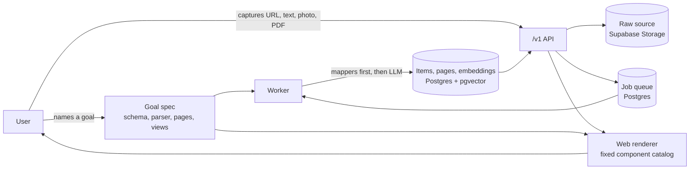

# Cauldron

Cauldron is a goal-driven capture-and-compile engine. You name a goal, like "Recipe Box" or "Research Library", and Cauldron turns the pages, text, photos and PDFs you capture into structured, searchable records grouped into summary pages. A goal is plain data: a schema, parsing rules, grouping rules and declarative view specs. Because of that, one shared skeleton can power many apps, and this repo uses it to build two. Cauldron is being built with Kiro for Kiroween 2026, in the Skeleton Crew category.

> **Status:** in development for Kiroween 2026. Nothing below is deployed yet. The repo currently holds the Kiro specs, the license and this README. Sections marked *planned* describe what the specs call for, not working features.

## The two apps

Both apps sit on the same skeleton. Each app folder is meant to contain only its goal spec, a thin web entry point and one custom component.

- **Recipe Box** (`apps/recipe-box`, planned). Captures recipes into structured `Recipe` items with servings, timings, ingredients and steps, grouped by cuisine and by your own collections. Its custom view is **Cooking Mode**: one step at a time, with step timers and voice "next".
- **Research Library** (`apps/research-library`, planned). Captures articles, arXiv papers, RSS items and PDFs into `Article` items with summaries, key points and topics, grouped into topic pages. Its custom view is the **Topic Page**, and it's built to find things from a vague memory, like "that piece about on-device models from last month".

## How it works

1. **Name a goal.** A goal holds a schema for its items, parser rules (deterministic mappers such as JSON-LD `Recipe` or arXiv metadata, plus LLM extraction rules), a page grouping rule, and JSON view specs for its screens. Every goal is checked by a validator before it's saved.
2. **Capture.** A signed-in user pastes a URL or text, or uploads photos or a PDF. The raw source is stored unchanged, and a compile job goes into a Postgres job queue.
3. **Compile.** A worker claims jobs from the queue. It fetches URLs through a locked-down fetcher, runs the deterministic mappers first, and calls the LLM only to fill fields the mappers missed. Output has to validate against the goal's schema. Failed extractions are retried, then kept with a `needs_review` status rather than dropped. Each field records where it came from.
4. **Index and group.** Items get embeddings for semantic search and are assigned to pages, and each page gets an LLM-written summary that links back to its items.
5. **Render.** The web apps draw every screen from the goal's view specs using a fixed component catalog. Specs are treated as data: no generated code is ever loaded or run.



Everything goes through the versioned `/v1` API: both web apps, the MCP server and the SDKs.

## Tech stack

All of this is planned; none of it is built yet.

- **Language:** TypeScript everywhere, in a pnpm workspace. Swift only for the Swift SDK and the optional iOS app.
- **Web apps:** Vite and TanStack Router (a client-side single-page app, not TanStack Start), TanStack Query, shadcn/ui and Tailwind CSS.
- **Auth:** Clerk, through `@clerk/clerk-react` on the web. Sign in with Apple through Clerk is planned for the iOS app. Supabase Auth is not used.
- **Data:** Supabase Postgres with row-level security, pgvector for semantic search, Postgres full-text search, and Supabase Storage for raw sources.
- **Backend services:**
  - the `/v1` public REST API, as its own service, with an OpenAPI description
  - a worker that claims compile jobs from a Postgres jobs table with `FOR UPDATE SKIP LOCKED` (no Redis)
  - a remote MCP server for creating goals, capturing and searching from any MCP client, with Clerk sign-in and hashed per-user API keys as a fallback
- **AI:** LLM calls go through OpenRouter behind a provider interface, with a mock for tests and demos. The model is set in config and will be chosen by a small bake-off. Embeddings use OpenAI `text-embedding-3-small`.
- **SDKs:** a TypeScript `/v1` client in `web-kit` and a Swift SDK.
- **Hosting:** everything runs on Railway. The tentative domain is `cauldron.trivetsoftware.com`, with `recipes.`, `library.`, `api.` and `mcp.` subdomains. None of this is final.

### Safety and abuse controls (planned)

- Postgres row-level security for tenant and user isolation
- daily LLM spend caps per user, per API key and per tenant, plus rate limits
- API keys shown once, stored only as hashes, scoped and revocable
- an SSRF-hardened fetcher: http and https only, private IP ranges blocked after DNS lookup, redirects re-checked, size and time limits
- captured content treated as untrusted: the compile step gets no tools and can't change goals or settings
- signed webhooks with replay protection
- a read-only public demo tenant for anonymous visitors, and a capped demo login for judges

## Repo layout

```
.kiro/specs/             Kiro specs, numbered in build order (present)
  01-foundation/         requirements, design and tasks (present)
  02-goal-engine/ … 12-ios-kit/   requirements (present)
core/                    shared domain logic: goal engine, capture, compile, search (planned)
web-kit/                 shared web renderer, component catalog, theme, auth, /v1 client (planned)
apps/recipe-box/         Recipe Box app (planned)
apps/research-library/   Research Library app (planned)
services/api/            /v1 API service (planned)
ios-kit/                 Swift package; the iOS app is a stretch goal (planned)
LICENSE                  MIT (present)
```

The worker and MCP server will run as their own Railway services. Their folders aren't fixed yet.

## Built with Kiro

Cauldron is being built with Kiro, mainly Kiro Crew. The work follows Kiro's spec-driven flow: each feature has a spec in `.kiro/specs/` with requirements, then a design and a task list, worked through in numbered order starting with `01-foundation`. Steering files and agent hooks will be added to `.kiro/` as the build goes on. The `.kiro/` folder is committed on purpose so anyone can see how the project was planned and built.

## Getting started

Setup instructions are coming once the foundation spec is built. There's nothing to install or run yet.

## License

[MIT](LICENSE), © 2026 Trivet Software LLC.
